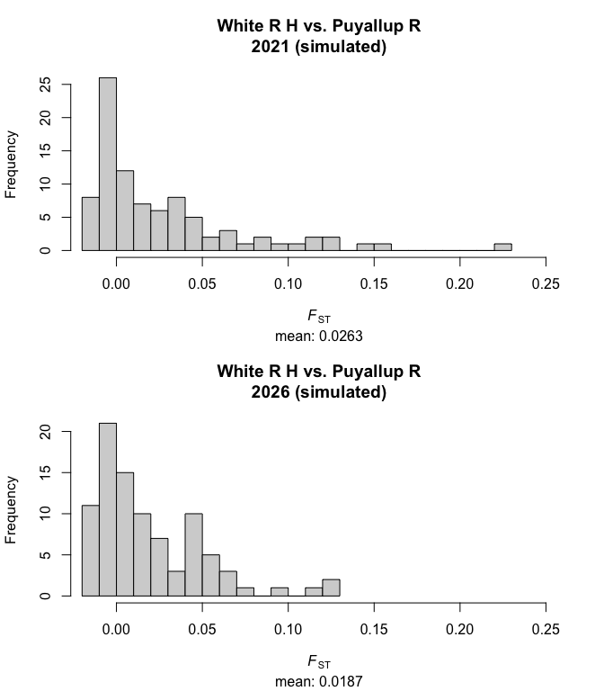
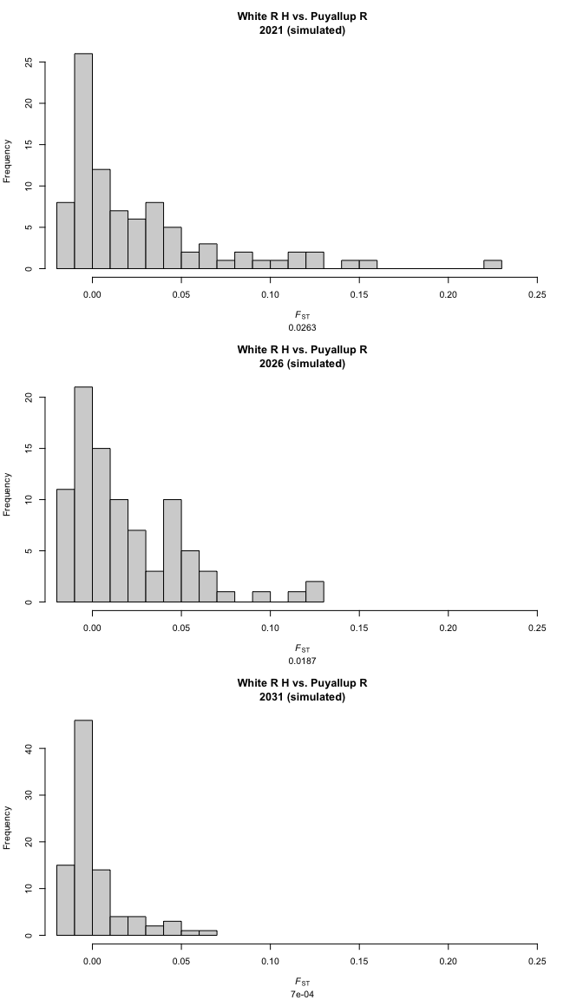

Puyallup Conservation Measures
================

Load packages.

``` r
library(tidyverse)
```

    ## ── Attaching core tidyverse packages ──────────────────────── tidyverse 2.0.0 ──
    ## ✔ dplyr     1.2.1     ✔ readr     2.2.0
    ## ✔ forcats   1.0.1     ✔ stringr   1.6.0
    ## ✔ ggplot2   4.0.3     ✔ tibble    3.3.1
    ## ✔ lubridate 1.9.5     ✔ tidyr     1.3.2
    ## ✔ purrr     1.2.2     
    ## ── Conflicts ────────────────────────────────────────── tidyverse_conflicts() ──
    ## ✖ dplyr::filter() masks stats::filter()
    ## ✖ dplyr::lag()    masks stats::lag()
    ## ℹ Use the conflicted package (<http://conflicted.r-lib.org/>) to force all conflicts to become errors

``` r
library(pegas)
```

    ## Loading required package: ape
    ## 
    ## Attaching package: 'ape'
    ## 
    ## The following object is masked from 'package:dplyr':
    ## 
    ##     where
    ## 
    ## 
    ## Attaching package: 'pegas'
    ## 
    ## The following object is masked from 'package:ape':
    ## 
    ##     mst

Import Chinook salmon genotypes from Van Doornick et al. 2024, filter
White River and Puyallup River samples, edit sample labels, and convert
format.

``` r
loci <- 
  read.loci(file="../../Chinook/loci.txt") |>
  filter(population %in% c("White_R_H_DFW", "Puyallup_R_DFW")) |>
  as_tibble() |>
  mutate(population=as.character(population) |> gsub(pattern="\\w{4}$", replacement="") |> factor()) |>
  as.loci()

loci
```

    ## Allelic data frame: 185 individuals
    ##                     94 loci
    ##                     1 additional variable

``` r
table(loci$population)
```

    ## 
    ## Puyallup_R  White_R_H 
    ##         94         91

There are 94 fish in Puyallup P sample and 91 in White R sample.

Lets randomly divide this dataset into 2 datasets.

``` r
set.seed(7)

B <- 
  slice_sample(loci, prop=0.5, by=population)

A <- 
  anti_join(x=loci, y=B)
```

    ## Joining with `by = join_by(population, ots_100884_287, ots_101119_381,
    ## ots_101554_407, ots_101704_143, ots_102457_132, ots_102801_308, ots_103041_52,
    ## ots_103122_180, ots_104063_132, ots_104415_88, ots_105105_613, ots_106747_239,
    ## ots_107074_284, ots_107285_93, ots_107806_821, ots_108007_208, ots_108390_329,
    ## ots_108820_336, ots_109693_392, ots_110495_380, ots_110551_64, ots_110689_218,
    ## ots_111681_657, ots_112301_43, ots_112820_284, ots_115987_325, ots_117242_136,
    ## ots_117259_271, ots_118175_479, ots_122414_56, ots_123048_521, ots_124774_477,
    ## ots_127760_569, ots_128757_61r, ots_129144_472, ots_129170_683, ots_129458_451,
    ## ots_130720_99, ots_131460_584, ots_131906_141, ots_94857_232r, ots_94903_99r,
    ## ots_96222_525, ots_96500_180, ots_96899_357r, ots_97077_179r, ots_99550_204,
    ## ots_aldb1_122, ots_arnt, ots_arp_436, ots_aspat_196, ots_cirpa, ots_ddx5_171,
    ## ots_est1363, ots_etif1a, ots_farsla_220, ots_gcsh, ots_gh2, ots_gpdh_338,
    ## ots_gph_318, ots_gst_207, ots_gth2b_550, ots_hnrnpl_533, ots_hsp27b_150,
    ## ots_igf_i_1_76, ots_il11, ots_isot, ots_lwsop_638, ots_mapkpr_151, ots_mhc2,
    ## ots_mybp_85, ots_nelfd_163, ots_nkef_192, ots_ntl_255, ots_p53, ots_parp3_286,
    ## ots_prl2, ots_redd1_187, ots_s7_1, ots_sclkf2r2_135, ots_sl, ots_stk6_516,
    ## ots_sws1op_182, ots_tlr3, ots_tpx2_125, ots_txnip_321, ots_u07_18_378,
    ## ots_u07_25_325, ots_u07_49_290, ots_u07_57_120, ots_u202_161, ots_u211_85,
    ## ots_u2446_123, ots_unk526)`

``` r
table(A$population); table(B$population)
```

    ## 
    ## Puyallup_R  White_R_H 
    ##         47         46

    ## 
    ## Puyallup_R  White_R_H 
    ##         47         45

Now we have 2 datasets. The 1st dataset (“A”) has 47 fish in the
Puyallup R sample and 46 fish in White R sample. The 2nd dataset (“B”)
has 47 fish in the Puyallup R sample and 45 fish in White R sample.

The purpose of these 2 datasets is to simulate data from different time
points.

Now lets estimate FST at these 2 simulated timepoints. FST is estimated
for each locus independently, so we’ll get n=94 FST estimates because
there are 94 SNPs. Some of these estimates will be `NA` just by chance
since there are loci with very low minor allele frequencies, they will
be fixed in the simulated datasets.

``` r
Fst_A <- 
  Fst(A)[, 2] |> 
  as.double()

Fst_B <- 
  Fst(B)[, 2] |> 
  as.double()
```

We take the mean of the n=94 FST estimates to get the FST value for
reporting. This is what is meant when we say “FST = 0.026”.. it’s the
mean FST of multiple loci.

``` r
mean(Fst_A, na.rm=TRUE)
```

    ## [1] 0.0262805

``` r
mean(Fst_B, na.rm=TRUE)
```

    ## [1] 0.01868376

These FSTs are different just by chance alone. Let’s plot the
distributions with the means below the x-axis.

``` r
par(mfrow=c(2, 1))

hist(Fst_A, breaks=30, xlim=c(min(c(Fst_A, Fst_B), na.rm=TRUE)*1.2, max(c(Fst_A, Fst_B), na.rm=TRUE)*1.1), main="White R H vs. Puyallup R\n2021 (simulated)", sub=paste("mean:", mean(Fst_A, na.rm=TRUE) |> round(digits=4)), xlab=expression(italic(F)[ST]))

hist(Fst_B, breaks=20, xlim=c(min(c(Fst_A, Fst_B), na.rm=TRUE)*1.2, max(c(Fst_A, Fst_B), na.rm=TRUE)*1.1), main="White R H vs. Puyallup R\n2026 (simulated)", sub=paste("mean:", mean(Fst_B, na.rm=TRUE) |> round(digits=4)), xlab=expression(italic(F)[ST]))
```

<!-- -->

These distributions and mean FSTs look slightly different. Are they
significantly different? We need a statistical test to answer that
question. We define our test statistic as the difference in mean FST
observed between these 2 simulated datasets:

``` r
mean(Fst_B, na.rm=TRUE) - 
  mean(Fst_A, na.rm=TRUE)
```

    ## [1] -0.007596733

This is negative and small, which would indicate a slight decrease of
genetic divergence between White R and Puyallup River that could be
expected to occur by chance alone.

Now let’s generate a null distribution of our test statistic. We do this
by (1) shuffling the FSTs between populations, (2) computing the mean
FSTs from these shuffled samples, (3) computing the difference of the
mean FSTs (i.e., the permuted test statistic), and (4) repeating steps
1-3 at least 1,000 times.

``` r
AB <- 
  c(Fst_A, Fst_B)

permute2samplet <- 
  function(x, n_loci){
    n <- n_loci*2
    idx_b <- sample(1:n, n_loci)
    idx_a <- setdiff(1:n, idx_b)
    mean_diff <- mean(x[idx_b], na.rm=TRUE) - mean(x[idx_a], na.rm=TRUE)
    return(mean_diff)}

permuteAB <- rep(NA, 1000)

set.seed(13)

for(i in 1:1000){permuteAB[i] <- permute2samplet(x=AB, n_loci=94)}

obsAB <-
  mean(Fst_B, na.rm=TRUE) - 
  mean(Fst_A, na.rm=TRUE)

par(mfrow=c(1, 1))

# 2-tailed p-value
mean(abs(c(permuteAB, obsAB)) >= abs(obsAB))
```

    ## [1] 0.1898102

``` r
hist(c(permuteAB, obsAB), xlab=expression(italic(F)[ST]~differences), breaks=30, main="Permutations")

abline(v=obsAB, lty=2, col="blue")
```

<!-- -->

``` r
set.seed(2)

C1 <- 
  filter(loci, population=="White_R_H") |> 
  slice_sample(prop=0.5) |> 
  as_tibble() |> 
  mutate(population=as.character(population))

C2 <- 
  anti_join(x=filter(loci, population=="White_R_H"), y=C1) |> 
  as_tibble() |> 
  mutate(population="Puyallup_R")
```

    ## Joining with `by = join_by(population, ots_100884_287, ots_101119_381,
    ## ots_101554_407, ots_101704_143, ots_102457_132, ots_102801_308, ots_103041_52,
    ## ots_103122_180, ots_104063_132, ots_104415_88, ots_105105_613, ots_106747_239,
    ## ots_107074_284, ots_107285_93, ots_107806_821, ots_108007_208, ots_108390_329,
    ## ots_108820_336, ots_109693_392, ots_110495_380, ots_110551_64, ots_110689_218,
    ## ots_111681_657, ots_112301_43, ots_112820_284, ots_115987_325, ots_117242_136,
    ## ots_117259_271, ots_118175_479, ots_122414_56, ots_123048_521, ots_124774_477,
    ## ots_127760_569, ots_128757_61r, ots_129144_472, ots_129170_683, ots_129458_451,
    ## ots_130720_99, ots_131460_584, ots_131906_141, ots_94857_232r, ots_94903_99r,
    ## ots_96222_525, ots_96500_180, ots_96899_357r, ots_97077_179r, ots_99550_204,
    ## ots_aldb1_122, ots_arnt, ots_arp_436, ots_aspat_196, ots_cirpa, ots_ddx5_171,
    ## ots_est1363, ots_etif1a, ots_farsla_220, ots_gcsh, ots_gh2, ots_gpdh_338,
    ## ots_gph_318, ots_gst_207, ots_gth2b_550, ots_hnrnpl_533, ots_hsp27b_150,
    ## ots_igf_i_1_76, ots_il11, ots_isot, ots_lwsop_638, ots_mapkpr_151, ots_mhc2,
    ## ots_mybp_85, ots_nelfd_163, ots_nkef_192, ots_ntl_255, ots_p53, ots_parp3_286,
    ## ots_prl2, ots_redd1_187, ots_s7_1, ots_sclkf2r2_135, ots_sl, ots_stk6_516,
    ## ots_sws1op_182, ots_tlr3, ots_tpx2_125, ots_txnip_321, ots_u07_18_378,
    ## ots_u07_25_325, ots_u07_49_290, ots_u07_57_120, ots_u202_161, ots_u211_85,
    ## ots_u2446_123, ots_unk526)`

``` r
C <- 
  bind_rows(C1, C2) |> 
  mutate(population=factor(population)) |>
  as.loci()

Fst_C <- 
  Fst(C)[, 2] |> 
  as.double()

mean(Fst_A, na.rm=TRUE)
```

    ## [1] 0.0262805

``` r
mean(Fst_B, na.rm=TRUE)
```

    ## [1] 0.01868376

``` r
mean(Fst_C, na.rm=TRUE)
```

    ## [1] 0.0007207086

``` r
par(mfrow=c(3, 1))

hist(Fst_A, breaks=30, xlim=c(min(c(Fst_A, Fst_B, Fst_C), na.rm=TRUE)*1.2, max(c(Fst_A, Fst_B, Fst_C), na.rm=TRUE)*1.1), main="White R H vs. Puyallup R\n2021 (simulated)", sub=mean(Fst_A, na.rm=TRUE) |> round(digits=4), xlab=expression(italic(F)[ST]))

hist(Fst_B, breaks=20, xlim=c(min(c(Fst_A, Fst_B, Fst_C), na.rm=TRUE)*1.2, max(c(Fst_A, Fst_B, Fst_C), na.rm=TRUE)*1.1), main="White R H vs. Puyallup R\n2026 (simulated)", sub=mean(Fst_B, na.rm=TRUE) |> round(digits=4), xlab=expression(italic(F)[ST]))

hist(Fst_C, breaks=10, xlim=c(min(c(Fst_A, Fst_B, Fst_C), na.rm=TRUE)*1.2, max(c(Fst_A, Fst_B, Fst_C), na.rm=TRUE)*1.1), main="White R H vs. Puyallup R\n2031 (simulated)", sub=mean(Fst_C, na.rm=TRUE) |> round(digits=4), xlab=expression(italic(F)[ST]))
```

<!-- -->

``` r
mean(Fst_C, na.rm=TRUE) - 
  mean(Fst_A, na.rm=TRUE)
```

    ## [1] -0.02555979

``` r
BC <- 
  c(Fst_B, Fst_C)

permuteBC <- rep(NA, 1000)

set.seed(13)

for(i in 1:1000){permuteBC[i] <- permute2samplet(x=BC, n_loci=94)}

obsBC <-
  mean(Fst_C, na.rm=TRUE) - 
  mean(Fst_B, na.rm=TRUE)
```

``` r
par(mfrow=c(1, 1))

# 2-tailed p-value
mean(abs(c(permuteBC, obsBC)) >= abs(obsBC))
```

    ## [1] 0.000999001

``` r
hist(c(permuteBC, obsBC), xlab=expression(italic(F)[ST]~differences), breaks=30, main=paste("p-value:", mean(abs(c(permuteBC, obsBC)) >= abs(obsBC)) |> round(digits=5)))

abline(v=obsBC, lty=2, col="blue")
```

<!-- -->
