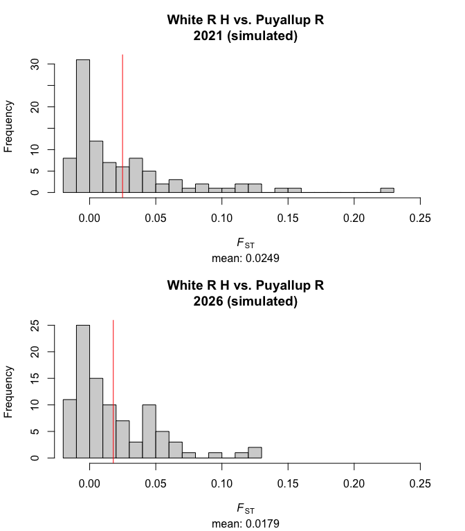
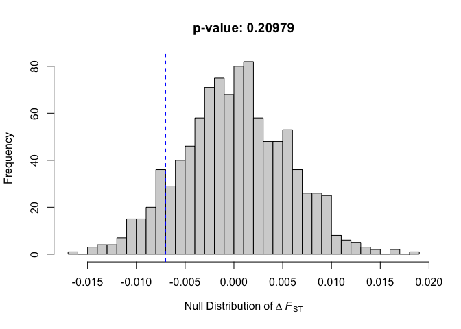
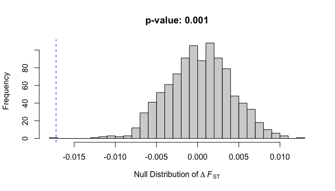

Statistical Hypothesis Test for Hybridization w/ Introgression
================
Tyler McCraney

This is an exploratory analysis of one idea I have for a statistical
hypothesis test for hybridization w/ introgression of White River spring
run and Puyallup River fall run Chinook salmon.

The White River spring run and Puyallup River fall run Chinook salmon
stocks exhibit a low degree of genetic structure (e.g., FST = 0.025) but
can be assigned with high certainty in GSI applications. The White R
stock is supplemented by conservation hatcheries while the Puyallup R
stock is supplemented by production hatcheries.

Concerns have been raised about the potential risk for loss of the
unique spring run life history of the smaller White River stock due to
hybridization w/ introgression with the larger Puyallup River fall run
stock. A genetics-based test is desired to determine if hybridization w/
introgression is increasing because of Puyallup R fall run production.

When hybridization w/ introgression happens, differences in allele
frequencies between populations are lost, So after this happens there
are no differences in allele frequencies between samples that are
greater than would be expected to happen by chance alone.

FST measures allele frequency differences between samples. It ranges
from 0, indicating no genetic difference between two samples, to 1,
indicating complete genetic difference between the two samples (i.e.,
when FST = 1, sample 1: 100% allele 1 and sample 2: 100% allele 2).

If hybridization w/ introgression is increasing, then I expect FST
estimates for White R spring run versus Puyallup River fall run to
decrease. Therefore, the test statistic is the difference in FST (∆FST)
estimated at time 1 (t1) and t2. For instance, if `FST = 0.025` at t1
and `FST = 0.005` at t2, then our test statistic is
`∆FST = 0.005 - 0.025 = -0.02`, Alternatively, ∆FST could be positive,
which would indicate an increase in FST estimated at t1 and t2.

We need a robust statistical hypothesis test to determine if our test
statistic is significantly greater than would be expected to occur by
chance alone. A 2-sample permutation test can be used to determine if
∆FST is greater than would be expected by chance alone. This is
essentially a non-parameteric version of the classic two-way t test: a
statistical hypothesis test that checks whether a difference between
means is statistically significant or likely due to chance. This
framework is appropriate because FST is actually the mean of many
independent FSTs estimated from multiple loci, so we want to determine
if the mean FST is significantly different at 2 sampling points.

To demonstrate the test, I simulate genetic data sampled at 3 different
time points: 2021, 2026, and 2031. I simulated the data so FST would
decrease substantially (by chance alone) from 2021 to 2026, and then
decrease significantly from 2026 to 2031 to simulate a hypothetical
scenario of hybridization of White River spring run and Puyallup River
fall run w/ complete introgression.

I purposely simulated data with small sample sizes and few loci that
would produce FST estimates with high stochastic error in order to
demonstrate how the statistical hypothesis test works. In practice,
large sample sizes and many loci are used.

First we import Chinook salmon genotypes from Van Doornick et al. 2024,
filter the White River and Puyallup River samples, edit the sample
labels, and convert the format so we can estimate FST with `pegas`.

``` r
library(tidyverse)
library(pegas)

loci <- 
  read.loci(file="../../Chinook/loci.txt") |>
  filter(population %in% c("White_R_H_DFW", "Puyallup_R_DFW")) |>
  as_tibble() |>
  mutate(population=as.character(population) |> gsub(pattern="\\w{4}$", replacement="") |> factor()) |>
  as.loci()

loci
```

    ## Allelic data frame: 185 individuals
    ##                     94 loci
    ##                     1 additional variable

``` r
table(loci$population)
```

    ## 
    ## Puyallup_R  White_R_H 
    ##         94         91

We see there are 94 fish in the Puyallup R sample and 91 fish in the
White R sample.

Lets randomly divide this data into 2 sets. This is random but I use
`set.seed` so we always get 2 datasets that I know will be quite
different (I tinkered with different seeds to find one that produced
different genotypes). If I didn’t use `set.seed` then this result
wouldn’t be reproducible.

``` r
set.seed(7)

B <- 
  slice_sample(loci, prop=0.5, by=population)

A <- 
  anti_join(x=loci, y=B)

table(A$population); table(B$population)
```

    ## 
    ## Puyallup_R  White_R_H 
    ##         47         46

    ## 
    ## Puyallup_R  White_R_H 
    ##         47         45

Okay, now we have 2 datasets. The 1st dataset “A” has 47 fish in the
Puyallup R sample and 46 fish in White R sample. The 2nd dataset “B” has
47 fish in the Puyallup R sample and 45 fish in White R sample.
Remember, the purpose of these 2 datasets is to simulate data sampled
from different time points.

Now lets estimate FST from data at these 2 simulated timepoints. FST is
estimated for each locus independently, so we’ll get n=94 FST estimates.
Some of these estimates will be `NA` just by chance, since there are
loci with very low minor allele frequencies, they will likely be fixed
in the simulated datasets. They are actually FST = 0 so lets fix that.

``` r
Fst_A <- 
  Fst(A)[, 2] |> 
  as.double()

Fst_B <- 
  Fst(B)[, 2] |> 
  as.double()

Fst_A[is.na(Fst_A)] <- 
  0

Fst_B[is.na(Fst_B)] <- 
  0
```

There were 5 SNPs fixed in the “A” data and 4 in the “B” data, and I set
those to all to 0.

Now let’s take the mean of the two independent n=94 FST estimates to get
the overall FST for sample A and sample B.

``` r
mean(Fst_A, na.rm=TRUE)
```

    ## [1] 0.0248826

``` r
mean(Fst_B, na.rm=TRUE)
```

    ## [1] 0.01788871

These FSTs are different just by chance alone. Let’s plot the
distributions with the mean FST annotated below the x-axis labels and
with a red line.

``` r
par(mfrow=c(2, 1))

hist(Fst_A, breaks=30, xlim=c(min(c(Fst_A, Fst_B), na.rm=TRUE)*1.2, max(c(Fst_A, Fst_B), na.rm=TRUE)*1.1), main="White R H vs. Puyallup R\n2021 (simulated)", sub=paste("mean:", mean(Fst_A, na.rm=TRUE) |> round(digits=4)), xlab=expression(italic(F)[ST])); abline(v=mean(Fst_A, na.rm=TRUE), col="red")

hist(Fst_B, breaks=20, xlim=c(min(c(Fst_A, Fst_B), na.rm=TRUE)*1.2, max(c(Fst_A, Fst_B), na.rm=TRUE)*1.1), main="White R H vs. Puyallup R\n2026 (simulated)", sub=paste("mean:", mean(Fst_B, na.rm=TRUE) |> round(digits=4)), xlab=expression(italic(F)[ST])); abline(v=mean(Fst_B, na.rm=TRUE), col="red")
```

<!-- -->

These distributions and mean FSTs look sort of different. Are they
significantly different? We need a statistical test to answer that…

Let’s define our test statistic as the difference in mean FSTs estimated
at 2 different timepoints: ∆FST.

``` r
mean(Fst_B, na.rm=TRUE) - mean(Fst_A, na.rm=TRUE)
```

    ## [1] -0.006993888

This is negative (by design), to simulate a noticible decrease of
genetic differentiation between White R and Puyallup River that might be
interpreted by a reasonable person to be “substantially different”, yet
it actually happened by chance alone.

Now let’s generate a null distribution of our test statistic. We do this
with a 4 step routine: (1) shuffle FSTs between populations, (2) compute
the mean FSTs from shuffled samples, (3) compute the difference of the
mean FSTs (i.e., the permuted ∆FST), and (4) repeat steps 1-3 999 times.

``` r
AB <- 
  c(Fst_A, Fst_B)

permute2samplet <- 
  function(x, n_loci){
    n <- n_loci*2
    idx_b <- sample(1:n, n_loci)
    idx_a <- setdiff(1:n, idx_b)
    mean_diff <- mean(x[idx_b], na.rm=TRUE) - mean(x[idx_a], na.rm=TRUE)
    return(mean_diff)}

permuteAB <- rep(NA, 1000)

set.seed(13)

for(i in 1:1000){permuteAB[i] <- permute2samplet(x=AB, n_loci=94)}
```

Okay now let’s calculate a non-parametric “p-value” for the test. This
is simply the proportion of the permuted test statistics that are more
extreme than our observed test statistic. We use the absolute values of
∆FSTs to make it 2-way, since we expect both FST increases and decreases
to occur just by chance alone in nature.

``` r
obsAB <-
  mean(Fst_B, na.rm=TRUE) - 
  mean(Fst_A, na.rm=TRUE)

par(mfrow=c(1, 1))

# 2-tailed p-value
mean(abs(c(permuteAB, obsAB)) >= abs(obsAB))
```

    ## [1] 0.2097902

``` r
hist(c(permuteAB, obsAB), xlab=expression(Null~Distribution~of~Delta~italic(F)[ST]), breaks=30, main=paste("p-value:", mean(abs(c(permuteAB, obsAB)) >= abs(obsAB)) |> round(digits=5)))

abline(v=obsAB, lty=2, col="blue")
```

<!-- -->

The observed test statistic is indicated by the blue dashed line. We see
a fair portion of the null distribution of the test statistic is more
extreme than the observed test statistic (we know that happened just by
chance alone), which is quantified by the “p-value”.

Now lets simulate a third dataset “C” that is designed to result in an
extreme decrease in the FST estimate. Under the scenario of
hybridization w/ introgression, the White R spring run and Puyallup R
fall run would become a single population, and the distinctiveness of
those 2 populations would be lost forever. Lets simulate that scenario
by creating White and Puyallup data that is really only from the White R
with half of the samples randomly labeled “Puyallup R”. We could do this
vice-versa and it would simulate the same scenario but I am not going to
show that.

``` r
set.seed(2)

C1 <- 
  filter(loci, population=="White_R_H") |> 
  slice_sample(prop=0.5) |> 
  as_tibble() |> 
  mutate(population=as.character(population))

C2 <- 
  anti_join(x=filter(loci, population=="White_R_H"), y=C1) |> 
  as_tibble() |> 
  mutate(population="Puyallup_R")

C <- 
  bind_rows(C1, C2) |> 
  mutate(population=factor(population)) |>
  as.loci()

Fst_C <- 
  Fst(C)[, 2] |> 
  as.double()

Fst_C[is.na(Fst_C)] <- 
  0

mean(Fst_A, na.rm=TRUE); mean(Fst_B, na.rm=TRUE); mean(Fst_C, na.rm=TRUE)
```

    ## [1] 0.0248826

    ## [1] 0.01788871

    ## [1] 0.0006900401

We can see above that our simulated data produced the desired pattern in
∆FST: slight decrease from t1 to t2 (e.g., 2021 to 2026) followed by an
extreme decrease from t2 to t3 (e.g., 2026 to 2031). Now lets plot these
distributions so we can see what that looks like.

``` r
par(mfrow=c(3, 1))

hist(Fst_A, breaks=30, xlim=c(min(c(Fst_A, Fst_B, Fst_C), na.rm=TRUE)*1.2, max(c(Fst_A, Fst_B, Fst_C), na.rm=TRUE)*1.1), main="White R H vs. Puyallup R\n2021 (simulated)", sub=paste("mean:", mean(Fst_A, na.rm=TRUE) |> round(digits=4)), xlab=expression(italic(F)[ST])); abline(v=mean(Fst_A, na.rm=TRUE), col="red")

hist(Fst_B, breaks=20, xlim=c(min(c(Fst_A, Fst_B, Fst_C), na.rm=TRUE)*1.2, max(c(Fst_A, Fst_B, Fst_C), na.rm=TRUE)*1.1), main="White R H vs. Puyallup R\n2026 (simulated)", sub=paste("mean:", mean(Fst_B, na.rm=TRUE) |> round(digits=4)), xlab=expression(italic(F)[ST])); abline(v=mean(Fst_B, na.rm=TRUE), col="red")

hist(Fst_C, breaks=10, xlim=c(min(c(Fst_A, Fst_B, Fst_C), na.rm=TRUE)*1.2, max(c(Fst_A, Fst_B, Fst_C), na.rm=TRUE)*1.1), main="White R H vs. Puyallup R\n2031 (simulated)", sub=paste("mean:", mean(Fst_C, na.rm=TRUE) |> round(digits=4)), xlab=expression(italic(F)[ST])); abline(v=mean(Fst_C, na.rm=TRUE), col="red")
```

<!-- -->

The pattern is clear: FST declines to zero as would be expected under
the scenario of hybridization w/ introgression. Now lets run the
statistical test to demonstrate how to quantify significance of ∆FST.

``` r
BC <- 
  c(Fst_B, Fst_C)

permuteBC <- rep(NA, 1000)

set.seed(13)

for(i in 1:1000){permuteBC[i] <- permute2samplet(x=BC, n_loci=94)}

obsBC <-
  mean(Fst_C, na.rm=TRUE) - 
  mean(Fst_B, na.rm=TRUE)

obsBC
```

    ## [1] -0.01719867

We see our observed test statistic above (`∆FST = -0.018`) indicating a
big decrease in FST. We compute the non-parametric “p-value” as in the
same manner as before but this time we see a very small p-value which
indicates a statistically significant difference in FST from t2 to t3.

``` r
par(mfrow=c(1, 1))

# 2-tailed p-value
mean(abs(c(permuteBC, obsBC)) >= abs(obsBC))
```

    ## [1] 0.000999001

``` r
hist(c(permuteBC, obsBC), xlab=expression(Null~Distribution~of~Delta~italic(F)[ST]), breaks=30, main=paste("p-value:", mean(abs(c(permuteBC, obsBC)) >= abs(obsBC)) |> round(digits=5)))

abline(v=obsBC, lty=2, col="blue")
```

<!-- -->

It’s clear in the figure above that none of the null distribution of the
test statistic is more extreme than the observed test statistic (which
we always include in the vector of null test statistics just to ensure
our p-value doesn’t compute as 0).

This is just one example of a possible genetic application to test for
hybridization w/ introgression. Another idea would be to use STRUCTURE
for this, which is more sophisticated but can also be difficult to
interpret.

One important thing would be to run through this test and any others
with the actual reference dataset used by DFW for this system. DFW has
excellent reference data for the Puyallup-White Chinook, and using
larger numbers of fish, say for example n=100 in each White R spring and
Puyallup R fall, to estimate FST of the full 298 SNP panel will result
in much less stochasticity of FST than the toy examples I presented
here, which had only 94 SNPs and about n=45 fish per population.
