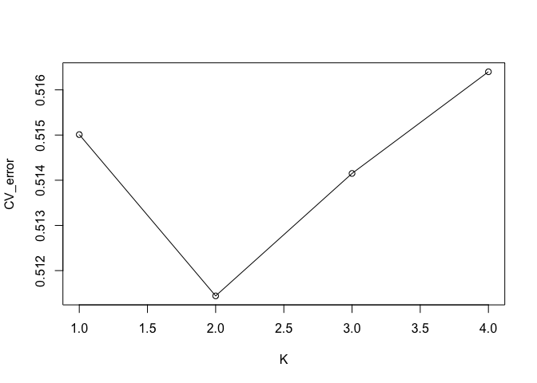
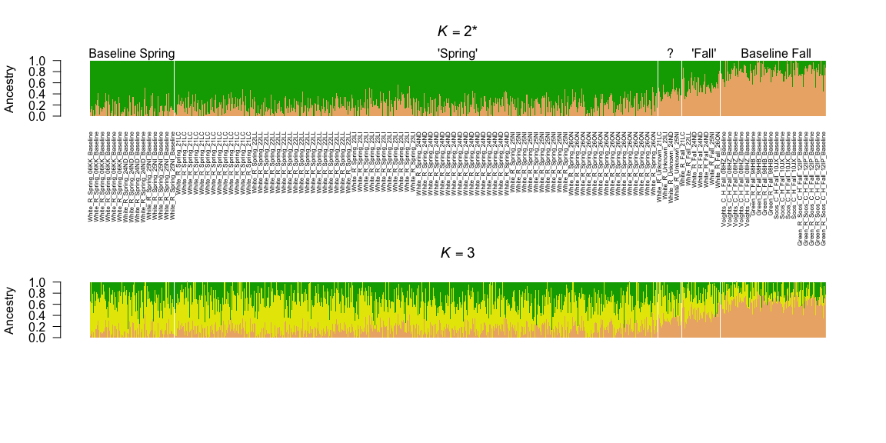
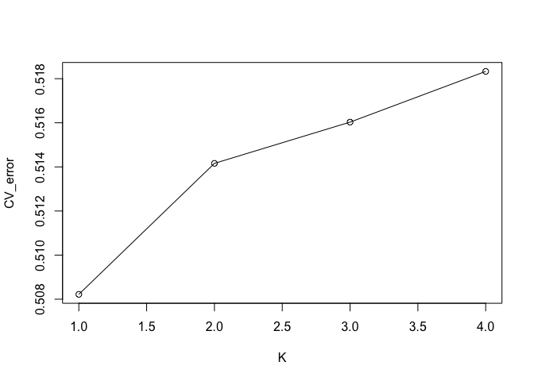
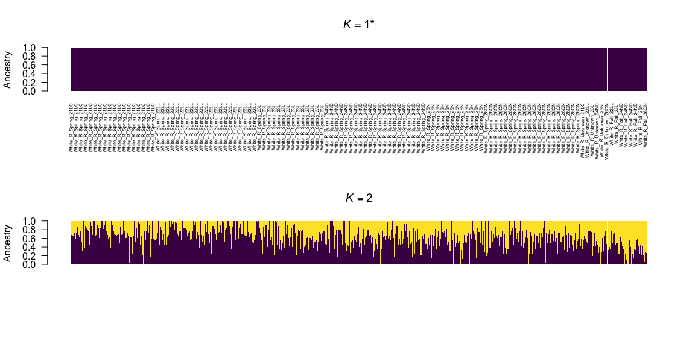

Ancestry Model for Classifying White River Spring Chinook Salmon
================
Tyler McCraney, Northwest Indian Fisheries Commission

#### Genetic Management of White River Spring (WRS) Chinook Salmon

#### Ancestry Model

#### WRS NOR & Baseline (WRS + Green River Fall)

``` zsh
conda activate admixture_Env

cd /Users/tylermccraney/Google\ Drive/My\ Drive/Puyallup-White/admixture

plink --file gdatw --make-bed --out gdatw

for K in 1 2 3 4; do admixture -s $RANDOM --cv=10 gdatw.bed $K | tee gdatw_log${K}.out; done

grep -h CV gdatw_log* > gdatw_log.txt
```

<!-- -->

<!-- -->

#### Interpretation of mixed-color barplots

#### Ancestry Model of WRS NORs

``` zsh
plink --file NOR --make-bed --out NOR

for K in 1 2 3 4; do admixture -s $RANDOM --cv=10 NOR.bed $K | tee NOR_log${K}.out; done

grep -h CV NOR_log* > NOR_log.txt
```

<!-- -->

<!-- -->
