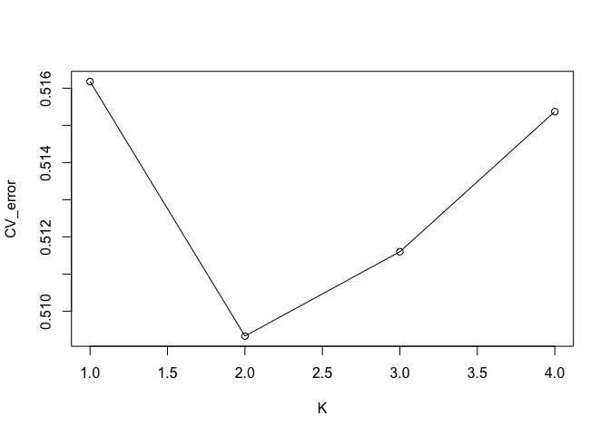

Ancestry Modeling White River Spring-run Chinook Salmon (Part 2)
================
Tyler McCraney

#### White River NORs & White-Puyallup (Green River Origin) Baseline

``` zsh
conda activate admixture_Env

cd /Users/tylermccraney/Google\ Drive/My\ Drive/Puyallup-White/admixture

plink --file gdatw2 --make-bed --out gdatw2

for K in 1 2 3 4; do admixture -s $RANDOM --cv=10 gdatw2.bed $K | tee gdatw2_log${K}.out; done

grep -h CV gdatw2_log* > gdatw2_log.txt
```

<!-- -->

<!-- -->

Sort ancestry. The ‘Fall’ class is defined by 0-40% ancestry, the
‘Hybrid’ class by 40-60% ancestry, and the ‘Spring’ class by 60-100%
ancestry.

<!-- -->

Baseline reporting groups (rows) assigned to ‘Spring’, ‘Fall’, or
‘Hybrid’ ancestry classes (columns). The ‘Fall’ class is defined by
0-40% ancestry, the ‘Hybrid’ class by 40-60% ancestry, and the ‘Spring’
class by 60-100% ancestry.

    ##         
    ##          Spring Hybrid Fall
    ##   Spring    213     12    0
    ##   Fall        1     18  237

White River NOR assignments (rows) assigned to ‘Spring’, ‘Fall’, or
‘Hybrid’ ancestry classes (columns). Ancestry classes defined same as
above.

    ##          
    ##           Spring Hybrid Fall
    ##   Spring     714     27    0
    ##   Unknown     16     18    2
    ##   Fall         9     34   15
