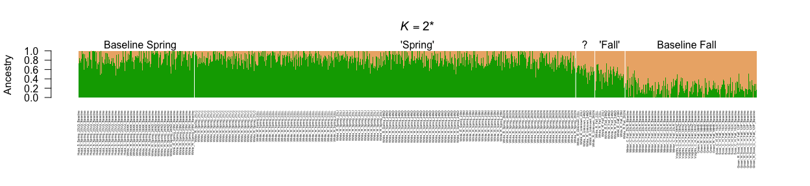
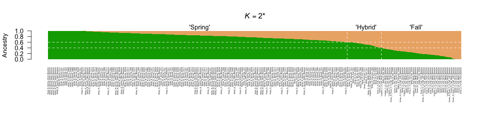

Ancestry Model for Classifying White River Spring Chinook Salmon
================
Tyler McCraney, Northwest Indian Fisheries Commission

#### Genetic Management of White River Spring (WRS) Chinook Salmon

#### Ancestry Model

#### WRS NOR & Baseline (WRS + Green River Fall)

``` zsh
conda activate admixture_Env

cd /Users/tylermccraney/Google\ Drive/My\ Drive/Puyallup-White/admixture

plink --file gdatw2 --make-bed --out gdatw2

for K in 1 2 3 4; do admixture -s $RANDOM --cv=10 gdatw2.bed $K | tee gdatw2_log${K}.out; done

grep -h CV gdatw2_log* > gdatw2_log.txt
```

<!-- -->

<!-- -->

#### Interpretation of mixed-color barplots

#### Classify fish as ‘Spring’, ‘Fall’, or ‘Hybrid’ based on their proportional ancestry

Sort fish by their *Spring* ancestry. The ‘Fall’ class is defined by
0.0-0.4 *Spring* ancestry, the ‘Hybrid’ class by 0.6-0.6 *Spring*
ancestry, and the ‘Spring’ class by 0.6-1.0 *Spring* ancestry.

<!-- -->

#### Ancestry classification of 100% baseline samples

Baseline reporting groups (in rows) assigned to ‘Spring’, ‘Fall’, or
‘Hybrid’ ancestry classes (in columns). The ‘Fall’ class is defined by
0.0-0.4 *Spring* ancestry, the ‘Hybrid’ class by 0.6-0.6 *Spring*
ancestry, and the ‘Spring’ class by 0.6-1.0 *Spring* ancestry.

    ##         
    ##          Spring Hybrid Fall
    ##   Spring    213     12    0
    ##   Fall        1     18  237

#### Ancestry classification of 100% WRS NORs

White River NOR assignments (in rows) assigned to ‘Spring’, ‘Fall’, or
‘Hybrid’ ancestry classes (in columns). The ‘Fall’ class is defined by
0.0-0.4 *Spring* ancestry, the ‘Hybrid’ class by 0.6-0.6 *Spring*
ancestry, and the ‘Spring’ class by 0.6-1.0 *Spring* ancestry.

    ##          
    ##           Spring Hybrid Fall
    ##   Spring     714     27    0
    ##   Unknown     16     18    2
    ##   Fall         9     34   15

#### Ancestry Model of WRS NORs
