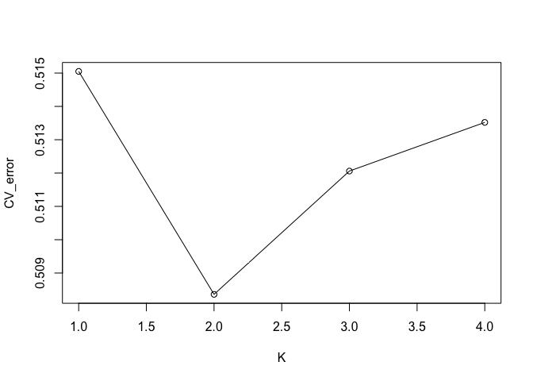
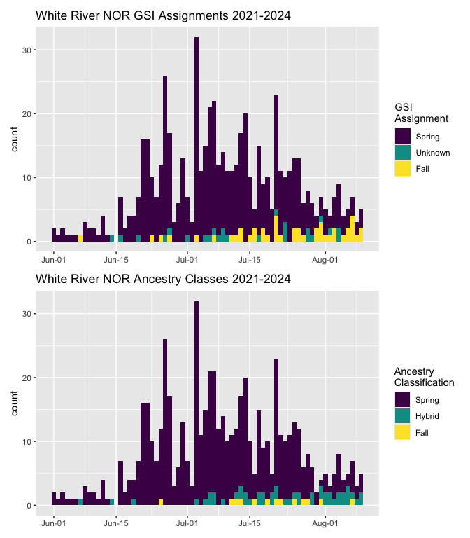

Ancestry Model for Classifying White River Spring-Run Natural Origin
Chinook Salmon
================
Tyler McCraney

#### White River NORs & White/Puyallup (Green River Origin) Baseline

This is the 3rd version of the (NOR + baseline) ancestry modeling
analysis. It is very similar to the [2nd
version](https://github.com/tylermccraney/Puyallup-White/blob/main/ancestry-models2.md)
except for a single locus *Ots_u07-07.161* that was removed because of
null alleles detected in the [2nd
version](https://github.com/tylermccraney/Puyallup-White/blob/main/delta-fst-test2.R)
of $\Delta F_{\text{ST}}$ analyses. The ADMIXTURE plots from version 2
and 3 look identical, but the classifications changed by a few counts.

ADMIXTURE is a command-line application that estimates individual
ancestry proportions from large multilocus SNP genotype datasets. It
uses the same statistical model as the classic STRUCTURE program, but
replaces slow MCMC sampling with fast maximum-likelihood optimization so
large datasets finish in minutes rather than hours.

Like STRUCTURE, ADMIXTURE requires you to specify ${K}$—the assumed
number of ancestral populations—in advance, although it uses
cross-validation (CV) to help pick the best ${K}$. For each value of
${K}$ = 1 to 4, ADMIXTURE first randomly partitions entries of the
genotype matrix into 10 folds, hides 10% of the genotype calls in each
fold, fits the ancestry and allele-frequency parameters on the remaining
90%, and measures how accurately those parameters predict the masked
genotypes. We plot this *CV_error* so we can see the ${K}$ value with
the lowest CV error, which will give us the best statistical fit.

We convert the genotype matrix into binary PLINK (.bed/.bim/.fam)
format, run ADMIXTURE, and then import the .Q files—containing estimated
ancestry fractions per individual—into R for plotting and summary.

``` bash
conda activate admixture_Env

cd /Users/tylermccraney/Google\ Drive/My\ Drive/Puyallup-White/admixture

plink --file gdatw3 --make-bed --out gdatw3

for K in 1 2 3 4; do admixture -s $RANDOM --cv=10 gdatw3.bed $K | tee gdatw3_log${K}.out; done

grep -h CV gdatw3_log* > gdatw3_log.txt
```

Now lets look at the results of ADMIXTURE. The R code is hidden in this
page but it can be found
[here](https://github.com/tylermccraney/Puyallup-White/blob/main/ancestry-models3.Rmd).

<!-- -->

Okay we have clear evidence indicating that ${K}$ = 2 should provide the
best statistical model fit. However, it is common practice to plot the
runner-up ${K}$ as well, so let’s do that.

<!-- -->

A mixed-color bar plot does not uniquely prove recent hybridization.
Since STRUCTURE/ADMIXTURE clustering algorithms reconstruct allele
frequencies by minimizing departures from Hardy-Weinberg and linkage
equilibrium, several different evolutionary and demographic scenarios
can produce the same patterns in bar plots. Here are a few common
examples for White R spring NOR and GRO baseline fall samples that could
be difficult or impossible to distinguish:

1.  If recent admixture occurred (true hybridization), White R spring
    and Green River fall were historically isolated, genetically
    differentiated parental populations that came into secondary contact
    and interbred. In this case, White R spring and Green River fall
    parental populations would appear as solid green and brown bars,
    respectively, while the hybrid population appears as a mosaic of
    those colors proportional to their genetic contribution.

2.  With ghost admixture (an unsampled source population), White R
    spring hybridizes with an unsampled or extinct “ghost” population
    other than Green River fall, though the ghost population shares more
    ancestry with Green River fall (e.g., Puyallup R fall). This forces
    the hybrid’s alleles to be modeled as a mixture of White R spring
    and Green River fall, creating a false impression of direct
    hybridization between the two sampled runs.

3.  With a recent population bottleneck, White R spring and Green River
    fall diverge from a common ancestor without any subsequent gene
    flow. White R spring then underwent a severe population bottleneck
    causing its allele frequencies to shift away from the ancestral
    state, while Green River fall population remains large and retains
    ancestral allele frequencies. In this scenario, STRUCTURE/ADMIXTURE
    would assign the bottlenecked White R spring population its own
    distinct cluster color and model the un-bottlenecked Green River
    fall population as an “admixed” intermediate between White R spring
    and Green River fall, even though hybridization did not occur.

It would be reasonable to assume all three of these scenarios—recent
hybridization, ghost admixture, and population bottleneck—have occurred
in with respect to White R spring and Green River fall, further
complicating the interpretation of results.

#### Classify (NOR and baseline) fish as ‘Spring’, ‘Fall’, or ‘Hybrid’ based on their proportional ancestry

In this section I apply a 80% threshold to classify fish as ‘Spring’,
‘Fall’, or ‘Hybrid’ by their proportional ancestry.

We can visualize what these classes look like by sorting fish by their
spring-like population ancestry. The ‘Spring’ class is defined by
1.0–0.6 spring ancestry, the ‘Hybrid’ class by 0.6–0.4 spring ancestry,
and the ‘Fall’ class by 0.4–0.0 spring ancestry.

<!-- -->

Baseline reporting groups (rows) assigned to ‘Spring’, ‘Fall’, or
‘Hybrid’ ancestry classes (columns). The ‘Fall’ class is defined by
0-40% ancestry, the ‘Hybrid’ class by 40-60% ancestry, and the ‘Spring’
class by 60-100% ancestry.

    ##         
    ##          Spring Hybrid Fall
    ##   Spring    214     11    0
    ##   Fall        1     18  237

White River NOR assignments (rows) assigned to ‘Spring’, ‘Fall’, or
‘Hybrid’ ancestry classes (columns). Ancestry classes defined same as
above.

    ##          
    ##           Spring Hybrid Fall
    ##   Spring     712     29    0
    ##   Unknown     15     19    2
    ##   Fall        10     33   15

Now let’s see if ADMIXTURE can sort the White River NORs into 2
ancestral populations. In other words, lets see if there’s any support
for splitting these phenotypically 100% spring-run fish into ‘Spring’
and ‘Fall’ classes.

``` bash
plink --file NOR3 --make-bed --out NOR3

for K in 1 2 3 4; do admixture -s $RANDOM --cv=10 NOR3.bed $K | tee NOR3_log${K}.out; done

grep -h CV NOR3_log*  > NOR3_log.txt
```

<!-- -->

<!-- -->

It’s interesting how ancestry of these phenotypically-spring run NORs
with ‘Unknown’ and ‘Fall’ run GSI assignments appears more fall-like
when the phenotypically-fall run baseline fish are included. I wonder if
that’s an artifact of incomplete sampling of ancestral diversity with
the closest ancestor unsampled. For instance, a scenario like long
branch attraction (LBA) in phylogenetics, where use of an outgroup
that’s too divergent from your ingroup can cause topology artifacts.
