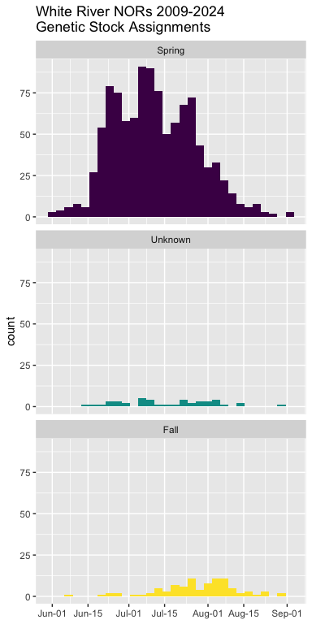
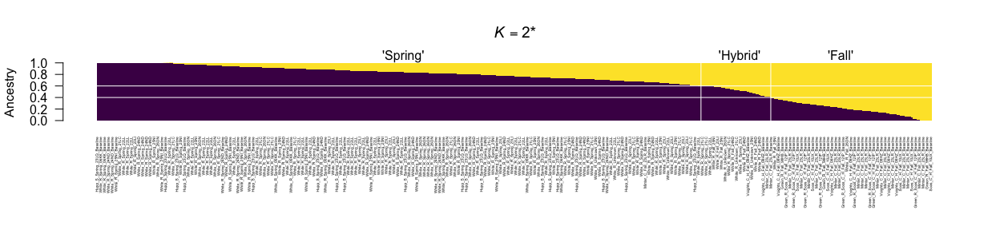
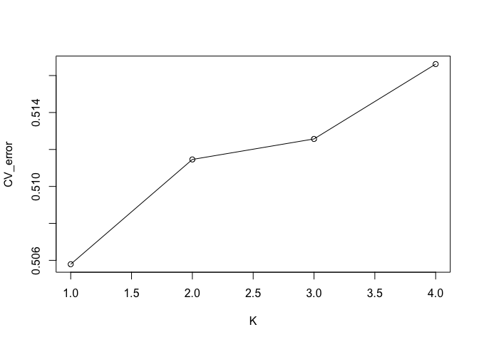

Ancestry Model for Classifying White River Spring Chinook Salmon
================
Tyler McCraney, Northwest Indian Fisheries Commission

### Genetic Management of White River Spring (WRS) Chinook Salmon

<!-- -->

Let’s break this plot apart by assignment, bin days, and visualize with
free y-scale to get sense of patterns.

<!-- -->

### Ancestry Model

ADMIXTURE is a command-line application that estimates individual
ancestry proportions from large SNP datasets. It uses the same model as
STRUCTURE, but replaces MCMC sampling with ML optimization, so runs
finish in just minutes instead of hours.

Just like STRUCTURE, ADMIXTURE requires you to specify ${K}$ (the
assumed number of ancestral populations) in advance, although it uses
cross-validation (CV) to help pick the best ${K}$. In this analysis we
will run ${K}=1-4$. For each value of ${K}=1-4$, ADMIXTURE randomly
partitions the genotype matrix into 10 folds, hides 10% of the genotype
calls in each fold, fits parameters of the ancestry and allele-frequency
model on the remaining 90%, and measures how accurately those parameters
predict the masked genotypes. This *CV error* is then plotted to see the
${K}$ value that produced the most accurate analysis, which should give
us the best statistical fit.

### WRS NOR & Baseline (WRS + Green River Fall)

We convert the genotype matrix into binary PLINK format
(.bed/.bim/.fam), run ADMIXTURE, and then import the .Q files
(containing estimated ancestry proportions per individual) into R for
plotting and summary.

``` bash
conda activate admixture_Env

cd /Users/tylermccraney/Google\ Drive/My\ Drive/Puyallup-White/admixture

plink --file gdatw3 --make-bed --out gdatw3

for K in 1 2 3 4; do admixture -s $RANDOM --cv=10 gdatw3.bed $K | tee gdatw3_log${K}.out; done

grep -h CV gdatw3_log* > gdatw3_log.txt
```

Now lets look at the results of ADMIXTURE. The R code is hidden in this
page but it can be found
[here](https://github.com/tylermccraney/Puyallup-White/blob/main/ancestry-models3.Rmd).

<!-- -->

We have clear evidence above indicating that ${K} = 2$ should provide
the best statistical fit. However, it is common practice to plot the
runner-up ${K}$ as well, in order to see if any grouping patterns are
visible but not accounted for by the best ${K}$. Let’s do that so we can
see if there’s any indication of more than 2 ancestral populations.

<!-- -->

The barplot for ${K} = 2^*$ shows the best statistical fit, and I don’t
see any patterns in the ${K} = 3$ barplot that would suggest the
presence of more than two ancestral populations.

### Interpretation of mixed-color barplots

At ${K} = 2^*$, Baseline Spring and ‘Spring’-assigned NORs have
*Spring-like* ancestry, whereas the Baseline Fall has *Fall-like*
ancestry. The ‘Fall’-assigned NOR ancestry appears intermediary to
*Spring-* and *Fall-like*. The ‘Unknown’ fish (i.e., fish with posterior
probability of GSI assignment to ‘Spring’ or ‘Fall’ reporting groups
\<0.8) appear to have ancestry intermediate to the ‘Spring’- and
‘Fall’-assigned NORs.

Now the question becomes, *what evolutionary or demographic processes
could have produced this pattern?*. One possible answer is
hybridization. However, a mixed-color bar plot does not uniquely prove
recent hybridization. The ADMIXTURE clustering algorithm reconstructs
allele frequencies by minimizing Hardy-Weinberg and Linkage
Disequilibrium (LD). Therefore, several different evolutionary and
demographic scenarios can produce the same pattern of mixed ancestry.
Here are a few common examples for White River Spring (WRS)
baseline+NORs and Green River Fall (GRF) baseline samples that could be
difficult to distinguish:

1.  If recent admixture occurred (true hybridization), then WRS and GRF
    were historically isolated, genetically differentiated parental
    populations that came into secondary contact and interbred. In this
    case, WRS and GRF parental populations would appear as solid purple
    and yellow bars, respectively, while the hybrid population appears
    as a mosaic of those colors proportional to their genetic
    contribution.

2.  If ghost admixture happened (hybrid w/ unsampled source population),
    WRS hybridized with an unsampled or possibly extinct “ghost”
    population that’s not GRF, although the ghost population shares more
    recent ancestry with GRF (e.g., the White or Puyallup River fall
    run). This forces the hybrid’s alleles to be modeled as a mixture of
    WRS and GRF, creating a false impression of direct hybridization
    between the two sampled lineages.

3.  If a population bottleneck occurred, WRS and GRF diverge from a
    common ancestor without any subsequent gene flow. WRS then underwent
    a severe population bottleneck causing its allele frequencies to
    shift away from the ancestral state, while GRF population remains
    large and retains ancestral allele frequencies. In this scenario,
    ADMIXTURE would assign the bottlenecked WRS population its own
    distinct cluster (purple color) and model the un-bottlenecked GRF
    population as an “admixed” intermediate between WRS and GRF, even
    though hybridization did not occur.

It would be reasonable to assume all three of these scenarios—recent
hybridization, ghost admixture, and population bottleneck—have occurred
with respect to WRS and GRF Chinook Salmon, further complicating the
interpretation of results.

### Classify fish as ‘Spring’, ‘Fall’, or ‘Hybrid’ based on their proportional ancestry

In this section I apply a 80% threshold to classify fish as ‘Spring’,
‘Fall’, or ‘Hybrid’ by their proportional ancestry. Then I compare the
classes to the assignments.

We can visualize what these classes look like by sorting fish by their
spring-like population ancestry. The ‘Spring’ class is defined by
1.0–0.6 spring ancestry, the ‘Hybrid’ class by 0.6–0.4 spring ancestry,
and the ‘Fall’ class by 0.4–0.0 spring ancestry.

<!-- -->

### Ancestry classification of baseline samples (WRS, GRF)

Let’s cross-tabulate the GSI assignments with the ancestry
classifications. We start by comparing the baseline reporting groupings
(‘Spring’ or ‘Fall’) with the ancestry classes (‘Spring’, ‘Hybrid’, or
‘Fall’). The baseline reporting group counts are in rows and the
ancestry classes in columns. So for example, 214 fish from the ‘Spring’
baseline reporting group were also classified as ‘Spring’ by ancestry,
whereas 11 of the fish from the ‘Spring’ baseline reporting group were
classified as ‘Hybrid’ by their ancestry. Keep in mind, these are 100%
baseline fish in this case (the reference samples which we base GSI of
mixtures on).

    ##         
    ##          Spring Hybrid Fall
    ##   Spring    214     11    0
    ##   Fall        1     18  237

It looks like the two baseline reporting groups correspond to ‘Spring’
and ‘Fall’ ancestry classes reasonably well. For example, only one
‘Fall’ reporting group baseline fish was classified as ‘Spring’ by it’s
ancestry. On the other hand, several fish were classified as ‘Hybrid’
although they are from the ‘Spring’ or ‘Fall’ baseline reporting group.

Let’s take a closer look at the baseline samples.

    ##                                      
    ##                                       Spring Hybrid Fall
    ##   Green_R_Fall_98HB_Baseline               0      1   38
    ##   Voights_C_H_Fall_08HZ_Baseline           0      3   39
    ##   Soos_C_H_Fall_10JX_Baseline              0      2   37
    ##   Green_R_Soos_C_H_Fall_12IP_Baseline      0      3   38
    ##   Hupp_S_Spring_23LQ_Baseline             89      7    0
    ##   Minter_C_Fall_23LR_Baseline              1      9   85
    ##   White_R_Spring_24ND_Baseline            40      2    0
    ##   White_R_Spring_25NI_Baseline            40      1    0

Okay, it looks like the Hupp Springs ‘Spring’ and Minter Creek ‘Fall’
baseline samples might contain more hybrid individuals relative to the
other baseline samples.

### Ancestry classification of WRS NORs

Let’s compare results for the White River Spring (WRS) NOR fish with the
ancestry classes (same as above).

    ##          
    ##           Spring Hybrid Fall
    ##   Spring     712     29    0
    ##   Unknown     15     19    2
    ##   Fall        10     33   15

White River NOR assignment counts (Rubias) are in rows and the ancestry
classification counts (ADMIXTURE) are in columns. We see n=712
‘Spring’-assigned fish are also classified as ‘Spring’ by their
ancestry, whereas n=29 of the ‘Spring’-assigned fish are classified as
‘Hybrid’ by their ancestry.

For the n=36 ‘Unknown’ fish (i.e., fish with posterior probability of
GSI assignment to ‘Spring’ or ‘Fall’ reporting groups \<0.8), we see
many of these fish are classified as either pure ‘Spring’ (n=15) or pure
‘Fall’ (n=2).

Results for the n=58 ‘Fall’-assigned fish are interesting. We see that
most of the ‘Fall’-assigned fish are classified as either ‘Hybrid’
(n=33) or pure ‘Spring’ (n=10) by their ancestry. This result is
consistent with my observation of these individuals in the ${K} = 2^*$
barplot (i.e., they appear admixed).

Let’s see how these assignment-X-ancestry cross-comparisons vary by year
for WRS NORs.

    ##                       
    ##                        Spring Hybrid Fall
    ##   White_R_Spring_21LC     117      5    0
    ##   White_R_Unknown_21LC      1      2    0
    ##   White_R_Fall_21LC         0      0    3
    ##   White_R_Spring_22LL     149      2    0
    ##   White_R_Unknown_22LL      5      1    0
    ##   White_R_Fall_22LL         4      2    1
    ##   White_R_Spring_23LI      90      5    0
    ##   White_R_Unknown_23LI      2      4    0
    ##   White_R_Fall_23LI         0      3    3
    ##   White_R_Spring_24ND     145      4    0
    ##   White_R_Unknown_24ND      4      5    1
    ##   White_R_Fall_24ND         4     16    5
    ##   White_R_Spring_25NI      83      2    0
    ##   White_R_Unknown_25NI      3      5    1
    ##   White_R_Fall_25NI         2      9    1
    ##   White_R_Spring_26ON     128     11    0
    ##   White_R_Unknown_26ON      0      2    0
    ##   White_R_Fall_26ON         0      3    2

I’m going to say it looks like something might have changed with GSI
assignments around 2024–2025, and then again in 2026. For instance, the
cross-tab counts appear relatively stable for 2021–2023, but then
there’s a big jump in ‘Fall’ assignments 2024–2025 which are
predominantly classified ‘Hybrid’ by ancestry (some are ‘Spring’ by
ancestry as well). Then in 2026, it looks like an abrupt increase in
‘Spring’ GSI assignments that are ‘Hybrid’ by ancestry, however the
relative frequency of fish classified ‘Spring’, ‘Hybrid’, and ‘Fall’
appears stable over all these years. I’d say it warrants further
investigation, but at least this demonstrates how valuable it can be to
repeat analyses using alternative methods.

Let’s wrap up this section by plotting the distribution of GSI
assignments and ancestry classes by arrival time at the Buckley Trap
(only for dates 2021–2024).

<!-- -->

The GSI assignments and ancestry classifications look similar overall.
The distribution of ancestry classifications is perhaps slightly more
organized by arrival time (i.e., less protracted).

### Ancestry Model of White River NORs

Let’s see if ADMIXTURE can put the White River NORs into 2 ancestral
populations. In other words, lets see if there’s any support for
splitting these phenotypically spring-run fish (i.e., most returned
between Jun-01 and Aug-01) into ‘Spring’ and ‘Fall’ populations.

``` bash
plink --file NOR3 --make-bed --out NOR3

for K in 1 2 3 4; do admixture -s $RANDOM --cv=10 NOR3.bed $K | tee NOR3_log${K}.out; done

grep -h CV NOR3_log*  > NOR3_log.txt
```

When the GRF fish are excluded, there is little support for WRS NORs
having ancestry from more than one ancestral population.

<!-- -->

But let’s plot ${K} = 2$ barplot just in case there’s some interesting
pattern to see.

<!-- -->

Hmmm…. there might be a pattern in the NOR-only ${K} = 2$ barplot. When
I look at the ‘Spring’-assigned fish, I see individuals with 0.0–1.0
*Spring* ancestry. However, when I look at the ‘Unknown’ (Unassigned), I
see several individuals with 0.0 *Spring* ancestry and only 1 individual
with 1.0 *Spring* ancestry. Finally, when look at the ‘Fall’-asigned
fish, I see many individuals with 0.0 *Spring* ancestry and no
individuals with 1.0 *Spring* ancestry.

It’s interesting how ancestry of these phenotypically-spring White River
NORs with ‘Unknown’ and ‘Fall’ run GSI assignments appears more
fall-like when the phenotypically-fall run baseline fish are included. I
wonder if that could be an artifact of incomplete sampling ancestral
population genetic diversity, where the closest ancestor of White River
Spring Chinook Salmon is unsampled.

### Final thoughts

I hypothesize the WRS ‘Fall’-assigned NORs are actually F1 hybrids of
WRS and some other population (possibly GRF, or maybe local Puyallup
River fall), and the ‘Unknown’ WRS NORs are progeny of the F1 hybrids
that backcrossed with WRS. I would like to test this hypothesis with a
Parentage Based Tagging (PBT) study of WRS NORs and HORs together with
GRF. Furthermore, I’d like to compare genetic diversity of the
*GREB1L/ROCK1* region (33 linked SNPs) to the neutral genetic background
(~250 SNPs).
