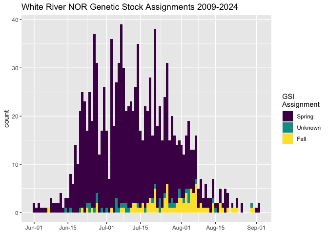
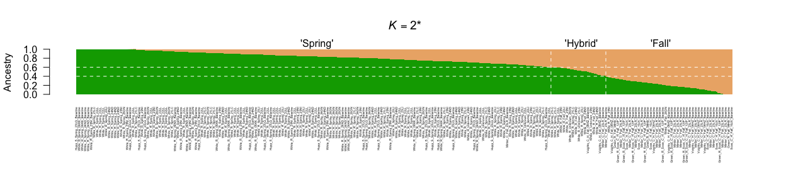
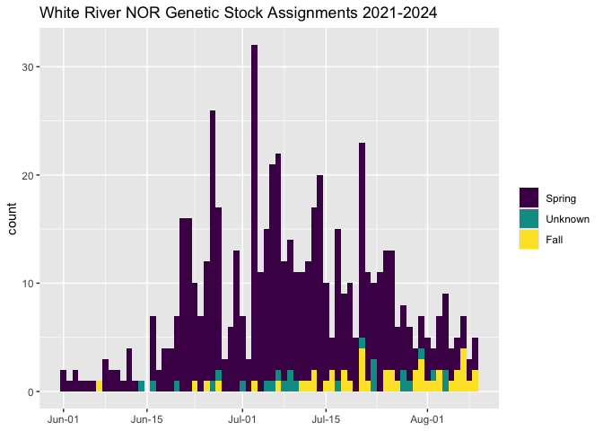
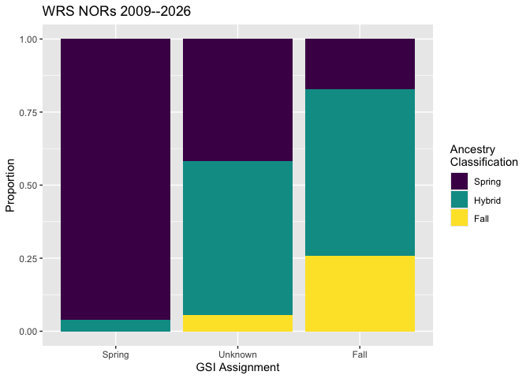

Ancestry Model for Classifying White River Spring Chinook Salmon
================
Tyler McCraney

This is the 3rd version of the (NOR + baseline) ancestry modeling
analysis. It is very similar to the [2nd
version](https://github.com/tylermccraney/Puyallup-White/blob/main/ancestry-models2.md)
except for a single locus *Ots_u07-07.161* that was removed because of
null alleles detected in the [2nd
version](https://github.com/tylermccraney/Puyallup-White/blob/main/scripts/delta-fst-test2.R)
of $\Delta F_{\text{ST}}$ analyses. The ADMIXTURE plots from version 2
and 3 look identical, but the classifications changed by a few counts.

#### Genetic Management of White River Spring Chinook Salmon

<!-- -->

Let’s break this plot apart by assignment, bin days, and visualize with
free y-scale to get sense of patterns.

<!-- -->

#### Ancestry Model

ADMIXTURE is a command-line application that estimates individual
ancestry proportions from large SNP datasets. It uses the same model as
STRUCTURE, but replaces MCMC sampling with ML optimization, so runs
finish in just minutes rather than hours.

Just like STRUCTURE, ADMIXTURE requires you to specify ${K}$ (the
assumed number of ancestral populations) in advance, although it uses
cross-validation (CV) to help pick the best ${K}$. For each value of
${K} = 1 - ...$, ADMIXTURE first randomly partitions entries of the
genotype matrix into 10 folds, hides 10% of the genotype calls in each
fold, fits the ancestry and allele-frequency parameters on the remaining
90%, and measures how accurately those parameters predict the masked
genotypes. The CV error is then plotted to see the ${K}$ value with the
lowest CV error, which should give us the best statistical fit.

#### White River NORs & White/Puyallup (Green River Origin) Baseline

We convert the genotype matrix into binary PLINK (.bed/.bim/.fam)
format, run ADMIXTURE, and then import the .Q files—containing estimated
ancestry fractions per individual—into R for plotting and summary.

``` bash
conda activate admixture_Env

cd /Users/tylermccraney/Google\ Drive/My\ Drive/Puyallup-White/admixture

plink --file gdatw3 --make-bed --out gdatw3

for K in 1 2 3 4; do admixture -s $RANDOM --cv=10 gdatw3.bed $K | tee gdatw3_log${K}.out; done

grep -h CV gdatw3_log* > gdatw3_log.txt
```

Now lets look at the results of ADMIXTURE. The R code is hidden in this
page but it can be found
[here](https://github.com/tylermccraney/Puyallup-White/blob/main/ancestry-models3.Rmd).

<!-- -->

We have clear evidence above indicating that ${K} = 2$ should provide
the best statistical fit. However, it is common practice to plot the
runner-up ${K}$ as well, in order to see if any grouping patterns are
visible but not accounted for by the best ${K}$. Let’s do that so we can
see if there’s any indication of more than 2 ancestral populations.

<!-- -->

The barplot for ${K} = 2^*$ shows the best statistical fit, and I don’t
see any patterns in the ${K} = 3$ barplot that would suggest the
presence of more than two ancestral populations.

#### Interpretation of mixed-color barplots

A mixed-color bar plot does not uniquely prove recent hybridization.
Since STRUCTURE/ADMIXTURE clustering algorithms reconstruct allele
frequencies by minimizing departures from Hardy-Weinberg and linkage
equilibrium, several different evolutionary and demographic scenarios
can produce the same patterns in bar plots. Here are a few common
examples for White R spring NOR and GRO baseline fall samples that could
be difficult or impossible to distinguish:

1.  If recent admixture occurred (true hybridization), White R spring
    and Green River fall were historically isolated, genetically
    differentiated parental populations that came into secondary contact
    and interbred. In this case, White R spring and Green River fall
    parental populations would appear as solid purple and yellow bars,
    respectively, while the hybrid population appears as a mosaic of
    those colors proportional to their genetic contribution.

2.  With ghost admixture (an unsampled source population), White R
    spring hybridizes with an unsampled or extinct “ghost” population
    other than Green River fall, though the ghost population shares more
    ancestry with Green River fall (e.g., Puyallup R fall). This forces
    the hybrid’s alleles to be modeled as a mixture of White R spring
    and Green River fall, creating a false impression of direct
    hybridization between the two sampled runs.

3.  With a recent population bottleneck, White R spring and Green River
    fall diverge from a common ancestor without any subsequent gene
    flow. White R spring then underwent a severe population bottleneck
    causing its allele frequencies to shift away from the ancestral
    state, while Green River fall population remains large and retains
    ancestral allele frequencies. In this scenario, STRUCTURE/ADMIXTURE
    would assign the bottlenecked White R spring population its own
    distinct cluster color and model the un-bottlenecked Green River
    fall population as an “admixed” intermediate between White R spring
    and Green River fall, even though hybridization did not occur.

It would be reasonable to assume all three of these scenarios—recent
hybridization, ghost admixture, and population bottleneck—have occurred
in with respect to White R spring and Green River fall, further
complicating the interpretation of results.

#### Classify fish as ‘Spring’, ‘Fall’, or ‘Hybrid’ based on their proportional ancestry

In this section I apply a 80% threshold to classify fish as ‘Spring’,
‘Fall’, or ‘Hybrid’ by their proportional ancestry.

We can visualize what these classes look like by sorting fish by their
spring-like population ancestry.

The ‘Spring’ class is defined by 1.0–0.6 spring ancestry, the ‘Hybrid’
class by 0.6–0.4 spring ancestry, and the ‘Fall’ class by 0.4–0.0 spring
ancestry.

<!-- -->

##### Ancestry classification of 100% baseline samples

Let’s cross-tabulate the GSI assignments with the ancestry
classifications. We start by comparing the baseline reporting groupings
(‘Spring’ or ‘Fall’) with the ancestry classes (‘Spring’, ‘Hybrid’, or
‘Fall’). The baseline reporting group counts are in rows and the
ancestry classes in columns. So for example, 214 fish from the ‘Spring’
baseline reporting group were also classified as ‘Spring’ by ancestry,
whereas 11 of the fish from the ‘Spring’ baseline reporting group were
classified as ‘Hybrid’ by their ancestry. Keep in mind, these are 100%
baseline fish in this case (the reference samples which we base GSI of
mixtures on).

    ##         
    ##          Spring Hybrid Fall
    ##   Spring    214     11    0
    ##   Fall        1     18  237

It looks like the two baseline reporting groups correspond to ‘Spring’
and ‘Fall’ ancestry classes reasonably well. For example, only one
‘Fall’ reporting group baseline fish was classified as ‘Spring’ by it’s
ancestry. On the other hand, several fish were classified as ‘Hybrid’
although they are from the ‘Spring’ or ‘Fall’ baseline reporting group.

##### Ancestry classification of 100% White River NORs

Let’s compare results for the White River NOR fish with the ancestry
classes same as above.

    ##          
    ##           Spring Hybrid Fall
    ##   Spring     712     29    0
    ##   Unknown     15     19    2
    ##   Fall        10     33   15

White River NOR assignment counts (Rubias) are in rows and the ancestry
classification counts (ADMIXTURE) are in columns. We see n=712
‘Spring’-assigned fish are also classified as ‘Spring’ by their
ancestry, whereas n=29 of the ‘Spring’-assigned fish are classified as
‘Hybrid’ by their ancestry.

For the n=36 ‘Unknown’ fish (i.e., fish with posterior probability of
GSI assignment to ‘Spring’ or ‘Fall’ reporting groups \<0.8), we see
that almost half (n=17) of these fish are classified as either pure
‘Spring’ (n=15) or pure ‘Fall’ (n=2).

Results for the n=58 ‘Fall’-assigned fish are interesting. We see that
most of the ‘Fall’-assigned fish are classified as either ‘Hybrid’
(n=33) or pure ‘Spring’ (n=10) by their ancestry.

##### Ancestry Model of White River NORs

Let’s see if ADMIXTURE can put the White River NORs into 2 ancestral
populations. In other words, lets see if there’s any support for
splitting these phenotypically spring-run fish (i.e., all returned
between Jun-01 and Aug-09) into ‘Spring’ and ‘Fall’ populations.

<!-- -->

``` bash
plink --file NOR3 --make-bed --out NOR3

for K in 1 2 3 4; do admixture -s $RANDOM --cv=10 NOR3.bed $K | tee NOR3_log${K}.out; done

grep -h CV NOR3_log*  > NOR3_log.txt
```

There is little support for these White River NORs to have ancestry from
more than one ancestral population when the Green River origin fall run
run fish are excluded.

<!-- -->

But let’s plot ${K} = 2$ barplot just in case there’s some interesting
pattern to see.

<!-- -->

I don’t see anything interesting in the NOR-only ${K} = 2$ barplot.

But I do think it’s interesting how ancestry of these
phenotypically-spring run NORs with ‘Unknown’ and ‘Fall’ run GSI
assignments appears more fall-like when the phenotypically-fall run
baseline fish are included. I wonder if that’s an artifact of incomplete
sampling of ancestral diversity with the closest ancestor unsampled. For
instance, a scenario like long branch attraction (LBA) in phylogenetics,
where use of an outgroup that’s too divergent from your ingroup can
cause topology artifacts.
