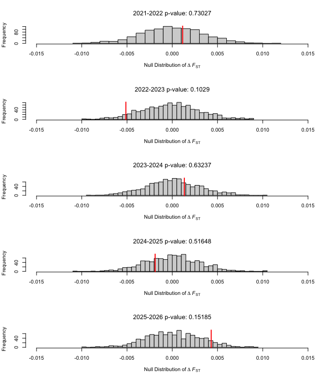

∆FST White River NORs 2021-2026 vs Green River Origin Fall
================
Tyler McCraney

The 1998 baseline samples were excluded. FST was estimated each year
with a random sample of 100 NORs and 100 fall baseline fish (2008, 2010,
and 2012). 95% CIs for FSTs were constructed by bootstrapping.
Non-parametric statistical hypothesis tests of ∆FST were are
non-statistically significant, indicating no hybridization w/
introgression is occurring between White River spring run and Green
River fall run Chinook Salmon.

    ## 
    ##          Green_R_Fall_98HB_Baseline Green_R_Soos_C_H_Fall_12IP_Baseline 
    ##                                  39                                  41 
    ##         Soos_C_H_Fall_10JX_Baseline      Voights_C_H_Fall_08HZ_Baseline 
    ##                                  39                                  42

<!-- -->

<!-- -->
