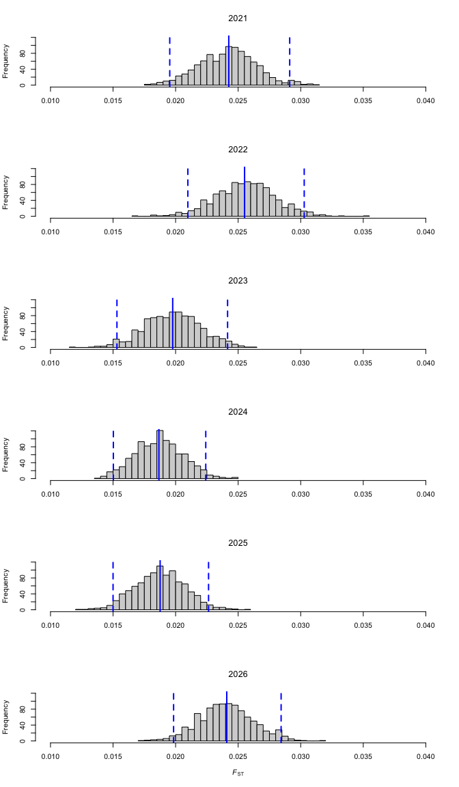
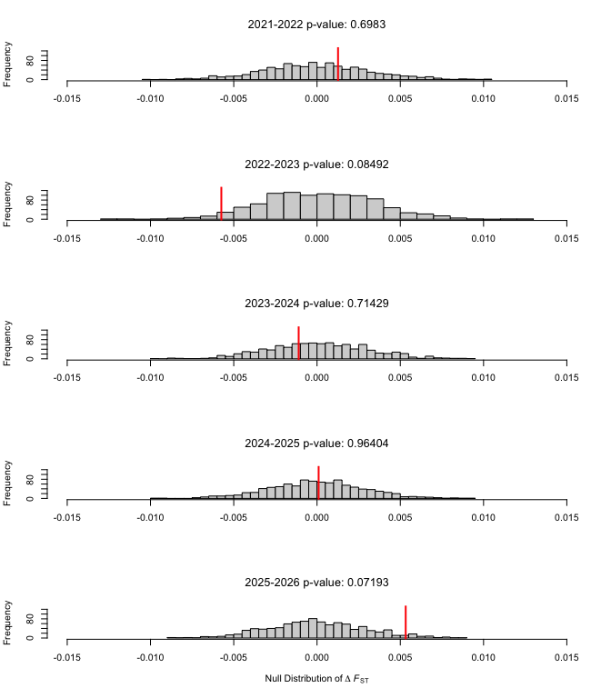

∆FST White River NORs 2021-2026 vs Green River Origin Fall
================
Tyler McCraney

#### Green River origin (GRO) fall-run Chinook salmon in DFW genetic baseline.

| Collection Name                     | N   |
|:------------------------------------|:----|
| Green_R_Fall_98HB_Baseline          | 39  |
| Green_R_Soos_C_H_Fall_12IP_Baseline | 41  |
| Soos_C_H_Fall_10JX_Baseline         | 39  |
| Voights_C_H_Fall_08HZ_Baseline      | 42  |

The 1998 baseline samples were excluded because there was high missing
data and I could not determine if they were hatchery or natural origin.

#### White River NORs (2021-2026) with genetic stock assignments.

| DFW Code | Genetic Stock Assignment | N   |
|:---------|:-------------------------|:----|
| 21LC     | White_R_Spring_21LC      | 122 |
| 21LC     | White_R_Fall_21LC        | 3   |
| 21LC     | White_R_Unknown_21LC     | 3   |
| 22LL     | White_R_Spring_22LL      | 151 |
| 22LL     | White_R_Fall_22LL        | 7   |
| 22LL     | White_R_Unknown_22LL     | 6   |
| 23LI     | White_R_Spring_23LI      | 95  |
| 23LI     | White_R_Fall_23LI        | 6   |
| 23LI     | White_R_Unknown_23LI     | 6   |
| 24ND     | White_R_Spring_24ND      | 149 |
| 24ND     | White_R_Fall_24ND        | 25  |
| 24ND     | White_R_Unknown_24ND     | 10  |
| 25NI     | White_R_Spring_25NI      | 85  |
| 25NI     | White_R_Fall_25NI        | 12  |
| 25NI     | White_R_Unknown_25NI     | 9   |
| 26ON     | White_R_Spring_26ON      | 139 |
| 26ON     | White_R_Fall_26ON        | 5   |
| 26ON     | White_R_Unknown_26ON     | 2   |

#### FST

FST was estimated each year by taking a random sample of n=100 White
River NORs (without regards to DFW genetic stock assignments) and a
random sample of n=100 GRO fall baseline fish (from the N=122 fish
available in the pooled 2008, 2010, and 2012 baseline collections). So,
there were a total of 6 FST estimates that were made over 2021 to 2026
between White River NORs and GRO fall run.

The 95% CIs for FSTs were constructed by bootstrapping. The
distributions of FST estimates with 95% CIs are plotted below. FST
estimates vary among years but 95% CIs overlap. Overlapping 95% CIs are
a heuristic for “not significantly different”.

<!-- -->

#### ∆FST

Non-parametric statistical hypothesis tests of ∆FST were all
non-significant, indicating that allele frequency differences between
White River NORs and GRO fall run Chinook salmon are maintained. In
other words, there is no evidence for hybridization w/ introgression
during the study period.

<!-- -->
