∆FST White River NORs 2021-2026 vs Green River Origin Fall (2nd Version)
================
Tyler McCraney

``` r
library(tidyverse)
library(pegas)
library(hierfstat)

gdatw <- 
  readRDS("../admixture/gdatw2.RDS")

gdatw$pop <- 
  gsub(pattern="River", replacement="R", gdatw$pop) |> 
  gsub(pattern="Creek", replacement="C") |> 
  gsub(pattern="Hatchery", replacement="H") |> 
  gsub(pattern="Chinook_", replacement="") |> 
  gsub(pattern="Buckley_Trap_", replacement="") |> 
  gsub(pattern="at_", replacement="_") |> 
  gsub(pattern="unclipped", replacement="Fall") |>
  gsub(pattern="_PBT", replacement="Fall") |>
  gsub(pattern="WDFW_FH", replacement="Fall") |>
  gsub(pattern="Spring_Fall_06KK", replacement="Spring_06KK_Baseline") |>
  gsub(pattern="R_24ND", replacement="R_Spring_24ND_Baseline") |>
  gsub(pattern="R_25NI", replacement="R_Spring_25NI_Baseline") |>
  gsub(pattern="fall", replacement="Fall") |>
  gsub(pattern="08HZ", replacement="08HZ_Baseline") |>
  gsub(pattern="98HB", replacement="98HB_Baseline") |>
  gsub(pattern="10JX", replacement="10JX_Baseline") |>
  gsub(pattern="12IP", replacement="12IP_Baseline") |>
  gsub(pattern="__", replacement="_") |>
  gsub(pattern="Hupp_Springs_23LQ", replacement="Hupp_S_Spring_23LQ_Baseline") |>
  gsub(pattern="Minter_C_23LR", replacement="Minter_C_Fall_23LR_Baseline")

gdatw_loci <- 
  reduce(
    names(gdatw) |> 
      grep("_a[12]$", x=_, value=TRUE) |> 
      sub("_a[12]$", "", x=_) |> 
      unique(),
    \(df, prefix){
      unite(
        df,
        col=!!prefix,
        matches(paste0("^", prefix, "_a[12]$")),
        sep="/",
        na.rm=TRUE)},
    .init=gdatw) |>
  mutate(across(7:258, ~na_if(., "")), across(.cols=c(7:258), ~factor(.))) |>
  select(-2:-6) |>
  rename(population=pop)

White_R_NOR <- 
  filter(gdatw_loci, !grepl(pattern="Baseline", population)) |>
  mutate(code=str_extract(string=population, pattern="\\w{4}$")) |>
  relocate(code, .before=1)

table(White_R_NOR$code)
```

    ## 
    ## 21LC 22LL 23LI 24ND 25NI 26ON 
    ##  128  164  107  184  106  146

``` r
Baseline_FALL <- 
  filter(gdatw_loci, grepl(pattern="Baseline", population)) |>
  filter(!grepl(pattern="Spring", population)) |>
  mutate(code=str_extract(string=population, pattern="\\d{2}\\w{2}")) |>
  relocate(code, .before=1)

table(Baseline_FALL$population)
```

    ## 
    ##          Green_R_Fall_98HB_Baseline Green_R_Soos_C_H_Fall_12IP_Baseline 
    ##                                  39                                  41 
    ##         Minter_C_Fall_23LR_Baseline         Soos_C_H_Fall_10JX_Baseline 
    ##                                  95                                  39 
    ##      Voights_C_H_Fall_08HZ_Baseline 
    ##                                  42

``` r
GRO_Fall <- 
  filter(Baseline_FALL, !code %in% c("98HB", "23LR")) 

table(GRO_Fall$population)
```

    ## 
    ## Green_R_Soos_C_H_Fall_12IP_Baseline         Soos_C_H_Fall_10JX_Baseline 
    ##                                  41                                  39 
    ##      Voights_C_H_Fall_08HZ_Baseline 
    ##                                  42

``` r
Minter_C_Fall_23LR <- 
  filter(Baseline_FALL, code=="23LR")

nor_fall <- 
  function(nor.code, fall){
    bind_rows(
      NOR=filter(White_R_NOR, code %in% nor.code), 
      FALL=fall, 
      .id="group") |>
      select(-population, -code) |>
      rename(population=group) |>
      mutate(population=factor(population)) |>
      as.loci()}

table(White_R_NOR$code)
```

    ## 
    ## 21LC 22LL 23LI 24ND 25NI 26ON 
    ##  128  164  107  184  106  146

``` r
y21a <- nor_fall(nor.code="21LC", fall=GRO_Fall)
y22a <- nor_fall(nor.code="22LL", fall=GRO_Fall)
y23a <- nor_fall(nor.code="23LI", fall=GRO_Fall)
y24a <- nor_fall(nor.code="24ND", fall=GRO_Fall)
y25a <- nor_fall(nor.code="25NI", fall=GRO_Fall)
y26a <- nor_fall(nor.code="26ON", fall=GRO_Fall)


y21b <- nor_fall(nor.code="21LC", fall=Minter_C_Fall_23LR)
y22b <- nor_fall(nor.code="22LL", fall=Minter_C_Fall_23LR)
y23b <- nor_fall(nor.code="23LI", fall=Minter_C_Fall_23LR)
y24b <- nor_fall(nor.code="24ND", fall=Minter_C_Fall_23LR)
y25b <- nor_fall(nor.code="25NI", fall=Minter_C_Fall_23LR)
y26b <- nor_fall(nor.code="26ON", fall=Minter_C_Fall_23LR)


perm_boot_fst <- 
  function(loci_yr1, loci_yr2, nperm=1000, nboot=1000, cores=max(1, detectCores()/2)){
    require(pegas)
    require(hierfstat)
    require(parallel)
    hf1 <- genind2hierfstat(loci2genind(loci_yr1))
    hf2 <- genind2hierfstat(loci2genind(loci_yr2))
    hf1[, 1] <- as.character(hf1[, 1])
    hf2[, 1] <- as.character(hf2[, 1])
    pops <- sort(unique(hf1[, 1]))
    if (!identical(pops, sort(unique(hf2[, 1])))){
      stop("Population labels must match between Year 1 and Year 2.")}
    if (!identical(names(hf1)[-1], names(hf2)[-1])){
      stop("Both years must contain the exact same SNPs in the same order.")}
    # Observed Fst and test statistic
    fst1 <- wc(hf1)$FST
    fst2 <- wc(hf2)$FST
    obs_diff <- fst2-fst1
    # Stratified Permutation (shuffle individuals between years within pops)
    hf_combined <- rbind(hf1, hf2)
    yr_vec <- c(rep(1, nrow(hf1)), rep(2, nrow(hf2)))
    pop_vec <- hf_combined[, 1]
    snp_mat <- hf_combined[, -1, drop=FALSE]
    null_diffs <- unlist(mclapply(seq_len(nperm), function(i){
      perm_yr <- yr_vec
      for (p in pops){
        idx <- which(pop_vec==p)
        perm_yr[idx] <- sample(yr_vec[idx], replace=FALSE)}
      p_fst1 <- wc(cbind(pop_vec[perm_yr==1], snp_mat[perm_yr==1, , drop=FALSE]))$FST
      p_fst2 <- wc(cbind(pop_vec[perm_yr==2], snp_mat[perm_yr==2, , drop=FALSE]))$FST
      p_fst2 - p_fst1}, 
      mc.cores=cores))
    # Paired Locus Bootstrap to generate 95% CI for the test statistic
    nloci <- ncol(hf1)-1
    pop1 <- hf1[, 1]; snps1 <- hf1[, -1, drop=FALSE]
    pop2 <- hf2[, 1]; snps2 <- hf2[, -1, drop=FALSE]
    boot_diffs <- unlist(
      mclapply(
        seq_len(nboot), 
        function(i){
          idx <- sample.int(nloci, nloci, replace=TRUE)
          b_fst1 <- wc(cbind(pop1, snps1[, idx, drop=FALSE]))$FST
          b_fst2 <- wc(cbind(pop2, snps2[, idx, drop=FALSE]))$FST
          b_fst2 - b_fst1}, 
        mc.cores=cores))
    # Two-way P-value & 95% CI
    null_clean <- null_diffs[!is.na(null_diffs)]
    null_mean <- mean(null_clean)
    p_val_two_sided <- (sum(abs(null_clean-null_mean)>=abs(obs_diff-null_mean))+1)/(length(null_clean)+1)
    ci <- quantile(boot_diffs, probs=c(0.025, 0.975), na.rm=TRUE)
    list(
      summary=c(
        Fst_Year1=round(fst1, 5),
        Fst_Year2=round(fst2, 5),
        Delta_Fst=round(obs_diff, 5),
        CI_Lower=round(as.numeric(ci[1]), 5),
        CI_Upper=round((as.numeric(ci[2])), 5),
        P_value=round(p_val_two_sided, 4)),
      null_differences=null_diffs,
      boot_differences=boot_diffs)}

# y21a_y22a <- perm_boot_fst(loci_yr1=y21a, loci_yr2=y22a, cores=10)
# y22a_y23a <- perm_boot_fst(loci_yr1=y22a, loci_yr2=y23a, cores=10)
# y23a_y24a <- perm_boot_fst(loci_yr1=y23a, loci_yr2=y24a, cores=10)
# y24a_y25a <- perm_boot_fst(loci_yr1=y24a, loci_yr2=y25a, cores=10)
# y25a_y26a <- perm_boot_fst(loci_yr1=y25a, loci_yr2=y26a, cores=10)
# 
# y21b_y22b <- perm_boot_fst(loci_yr1=y21b, loci_yr2=y22b, cores=10)
# y22b_y23b <- perm_boot_fst(loci_yr1=y22b, loci_yr2=y23b, cores=10)
# y23b_y24b <- perm_boot_fst(loci_yr1=y23b, loci_yr2=y24b, cores=10)
# y24b_y25b <- perm_boot_fst(loci_yr1=y24b, loci_yr2=y25b, cores=10)
# y25b_y26b <- perm_boot_fst(loci_yr1=y25b, loci_yr2=y26b, cores=10)

# saveRDS(y21a_y22a, "../data/y21a_y22a_0.RDS")
# saveRDS(y22a_y23a, "../data/y22a_y23a_0.RDS")
# saveRDS(y23a_y24a, "../data/y23a_y24a_0.RDS")
# saveRDS(y24a_y25a, "../data/y24a_y25a_0.RDS")
# saveRDS(y25a_y26a, "../data/y25a_y26a_0.RDS")
# saveRDS(y21b_y22b, "../data/y21b_y22b_0.RDS")
# saveRDS(y22b_y23b, "../data/y22b_y23b_0.RDS")
# saveRDS(y23b_y24b, "../data/y23b_y24b_0.RDS")
# saveRDS(y24b_y25b, "../data/y24b_y25b_0.RDS")
# saveRDS(y25b_y26b, "../data/y25b_y26b_0.RDS")

y21a_y22a <- readRDS("../data/y21a_y22a_0.RDS")
y22a_y23a <- readRDS("../data/y22a_y23a_0.RDS")
y23a_y24a <- readRDS("../data/y23a_y24a_0.RDS")
y24a_y25a <- readRDS("../data/y24a_y25a_0.RDS")
y25a_y26a <- readRDS("../data/y25a_y26a_0.RDS")
y21b_y22b <- readRDS("../data/y21b_y22b_0.RDS")
y22b_y23b <- readRDS("../data/y22b_y23b_0.RDS")
y23b_y24b <- readRDS("../data/y23b_y24b_0.RDS")
y24b_y25b <- readRDS("../data/y24b_y25b_0.RDS")
y25b_y26b <- readRDS("../data/y25b_y26b_0.RDS")

dat <-
  rbind(
    y21a_y22a=y21a_y22a$summary, 
    y21b_y22b=y21b_y22b$summary, 
    y22a_y23a=y22a_y23a$summary, 
    y22b_y23b=y22b_y23b$summary, 
    y23a_y24a=y23a_y24a$summary, 
    y23b_y24b=y23b_y24b$summary, 
    y24a_y25a=y24a_y25a$summary, 
    y24b_y25b=y24b_y25b$summary, 
    y25a_y26a=y25a_y26a$summary, 
    y25b_y26b=y25b_y26b$summary) |>
  as.data.frame() |>
  rownames_to_column(var="Set") |>
  mutate(
    Fall_pop=ifelse(
      grepl(pattern="a$", Set), 
      yes="08HZ_10JX_12IP", 
      no="23LR"),
    Year1=factor(
      Set, 
      levels=c("y21a_y22a", "y22a_y23a", "y23a_y24a", "y24a_y25a", "y25a_y26a", "y21b_y22b", "y22b_y23b", "y23b_y24b", "y24b_y25b", "y25b_y26b"),
      labels=c("2021", "2022", "2023", "2024", "2025", "2021", "2022", "2023", "2024", "2025")) |> as.character() |> as.numeric(),
    Year2=factor(
      Set, 
      levels=c("y21a_y22a", "y22a_y23a", "y23a_y24a", "y24a_y25a", "y25a_y26a", "y21b_y22b", "y22b_y23b", "y23b_y24b", "y24b_y25b", "y25b_y26b"),
      labels=c("2022", "2023", "2024", "2025", "2026", "2022", "2023", "2024", "2025", "2026")) |> as.character() |> as.numeric(),
    Year=(Year1+Year2)/2)

ggplot(dat, aes(x=Year, y=Delta_Fst, ymin=CI_Lower, ymax=CI_Upper)) + 
  geom_hline(yintercept=0, colour="white", linewidth=1) +
  geom_pointrange(position=position_dodge(width=0.2), shape=1) + 
  geom_path(position=position_dodge(width=0.2), linetype=2) + 
  facet_wrap(vars(Fall_pop), ncol=1) +
  labs(
    y=expression(Delta~italic(F)[ST]), 
    title=expression(Delta~italic(F)[ST]~varies~with~respect~to~baseline~data~source))
```

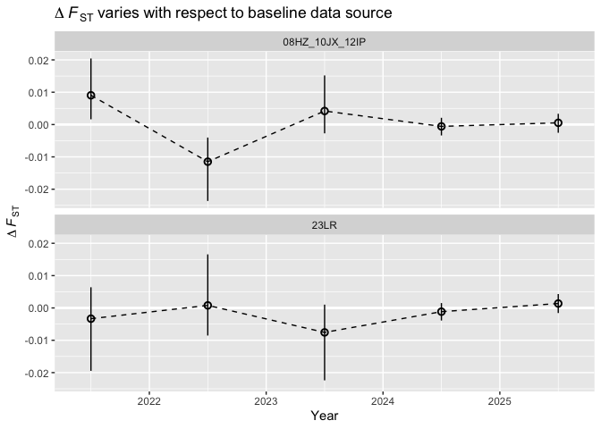<!-- -->

``` r
# In this figure, the same White River NORs are used with different 'Fall' baseline populations to demonstrate how sensitive this method is to teh distribution of allele frequencies. The 08HZ_10JX_12IP baseline population consists of 122 'Fall' fish from Puyallup River and Soos Creek. The 23LR baseline population is composed of 95 'Fall' fish from Minter Creek.


# null allele
Fst(y21b)[, 'Fst'] |> hist(breaks=30, main=NULL, xlab=NULL)
```

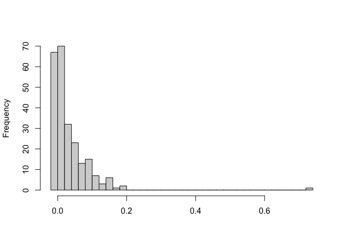<!-- -->

``` r
Fst(y21b)[, 'Fst'] |> sort() |> tail(1)
```

    ## ots_u07_07_161 
    ##      0.7250443

``` r
table(y21b$population, y21b$ots_u07_07_161, useNA="ifany")
```

    ##       
    ##        C/C C/T T/T <NA>
    ##   FALL  53  37   5    0
    ##   NOR    0   0  71   57

``` r
Fst(y22b)[, 'Fst'] |> hist(breaks=30, main=NULL, xlab=NULL)
```

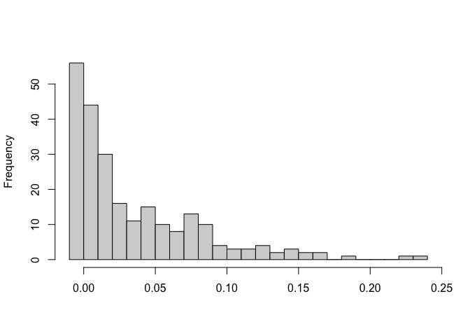<!-- -->

``` r
Fst(y22b)[, 'Fst'] |> sort() |> tail(1)
```

    ## ots_u202_161 
    ##    0.2397849

``` r
table(y22b$population, y22b$ots_u07_07_161, useNA="ifany")
```

    ##       
    ##        C/C C/T T/T
    ##   FALL  53  37   5
    ##   NOR   66  79  19

``` r
Fst(y23b)[, 'Fst'] |> hist(breaks=30, main=NULL, xlab=NULL)
```

<!-- -->

``` r
Fst(y23b)[, 'Fst'] |> sort() |> tail(1)
```

    ## ots_u07_07_161 
    ##      0.7136582

``` r
table(y23b$population, y23b$ots_u07_07_161, useNA="ifany")
```

    ##       
    ##        C/C C/T T/T <NA>
    ##   FALL  53  37   5    0
    ##   NOR    0   0  62   45

``` r
Fst(y24b)[, 'Fst'] |> hist(breaks=30, main=NULL, xlab=NULL)
```

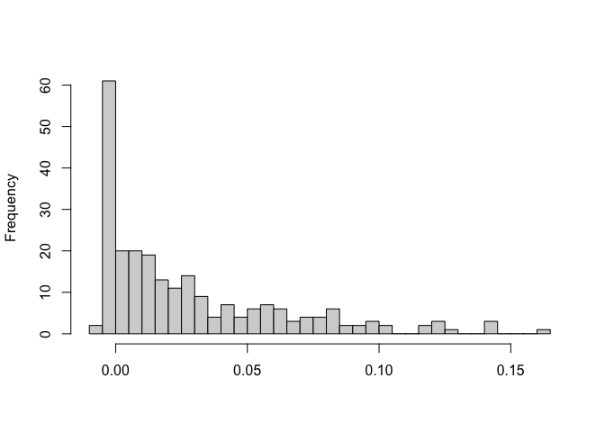<!-- -->

``` r
Fst(y24b)[, 'Fst'] |> sort() |> tail(1)
```

    ## ots_crrad28677_65 
    ##         0.1612426

``` r
table(y24b$population, y24b$ots_u07_07_161, useNA="ifany")
```

    ##       
    ##        C/C C/T T/T <NA>
    ##   FALL  53  37   5    0
    ##   NOR   76  82  25    1

``` r
Fst(y25b)[, 'Fst'] |> hist(breaks=30, main=NULL, xlab=NULL)
```

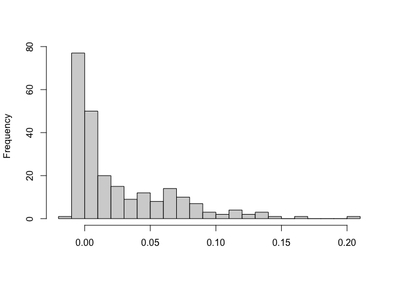<!-- -->

``` r
Fst(y25b)[, 'Fst'] |> sort() |> tail(1)
```

    ## ots_crrad28677_65 
    ##         0.2090271

``` r
table(y25b$population, y25b$ots_crrad28677_65, useNA="ifany")
```

    ##       
    ##        C/C C/T T/T <NA>
    ##   FALL  21  46  27    1
    ##   NOR   60  29   4   13

``` r
Fst(y26b)[, 'Fst'] |> hist(breaks=30, main=NULL, xlab=NULL)
```

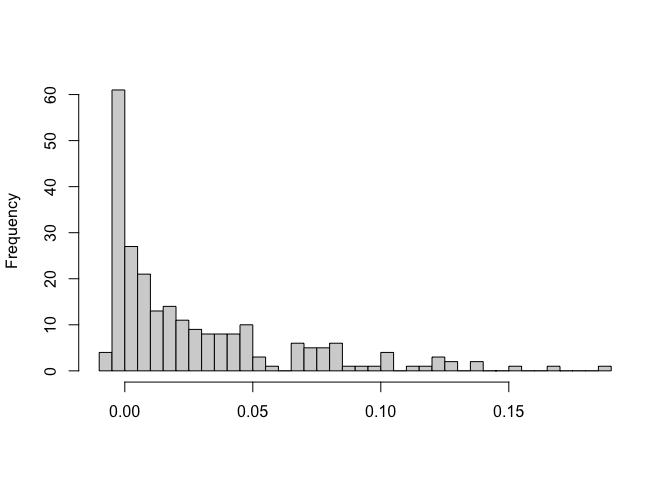<!-- -->

``` r
Fst(y26b)[, 'Fst'] |> sort() |> tail(1)
```

    ## ots_u07_53_133 
    ##      0.1871711

``` r
table(y26b$population, y26b$ots_u07_07_161, useNA="ifany")
```

    ##       
    ##        C/C C/T T/T <NA>
    ##   FALL  53  37   5    0
    ##   NOR   59  61  25    1

``` r
baseline_og <-
  read_tsv(
    "../data-from-Amelia/Updated_WhiteRiverChinookBaseline_RubiasInput.txt",
    col_types=str_flatten(rep("c", 594)),
    na="NA")

table(baseline_og$repunit, useNA="ifany")
```

    ## 
    ## HuppSprings_Hatchery_Spring   MinterCreek_Hatchery_Fall 
    ##                          96                          95 
    ##     SoosCreek_Hatchery_Fall  VoightsCreek_Hatchery_Fall 
    ##                         120                          43 
    ##  WhiteRiver_Hatchery_Spring           WhiteRiver_Spring 
    ##                          83                          46

``` r
table(baseline_og$repunit, baseline_og$Ots_u07_07_161_1, useNA="ifany")
```

    ##                              
    ##                                C  T <NA>
    ##   HuppSprings_Hatchery_Spring 80 16    0
    ##   MinterCreek_Hatchery_Fall   90  5    0
    ##   SoosCreek_Hatchery_Fall     28 29   63
    ##   VoightsCreek_Hatchery_Fall   0 19   24
    ##   WhiteRiver_Hatchery_Spring  70 10    3
    ##   WhiteRiver_Spring            0 23   23

``` r
table(baseline_og$repunit, baseline_og$Ots_u07_07_161_2, useNA="ifany")
```

    ##                              
    ##                                C  T <NA>
    ##   HuppSprings_Hatchery_Spring 31 65    0
    ##   MinterCreek_Hatchery_Fall   53 42    0
    ##   SoosCreek_Hatchery_Fall     22 35   63
    ##   VoightsCreek_Hatchery_Fall   0 19   24
    ##   WhiteRiver_Hatchery_Spring  32 48    3
    ##   WhiteRiver_Spring            0 23   23

``` r
table(baseline_og$repunit, paste(baseline_og$Ots_u07_07_161_1, baseline_og$Ots_u07_07_161_2, sep="/") |> na_if("NA/NA"), useNA="ifany")
```

    ##                              
    ##                               C/C C/T T/T <NA>
    ##   HuppSprings_Hatchery_Spring  31  49  16    0
    ##   MinterCreek_Hatchery_Fall    53  37   5    0
    ##   SoosCreek_Hatchery_Fall      22   6  29   63
    ##   VoightsCreek_Hatchery_Fall    0   0  19   24
    ##   WhiteRiver_Hatchery_Spring   32  38  10    3
    ##   WhiteRiver_Spring             0   0  23   23

``` r
table(baseline_og$collection, paste(baseline_og$Ots_u07_07_161_1, baseline_og$Ots_u07_07_161_2, sep="/") |> na_if("NA/NA"), useNA="ifany")
```

    ##                                                          
    ##                                                           C/C C/T T/T <NA>
    ##   Green_River__Soos_Creek_Hatchery_unclipped_Chinook_12IP   0   0  14   28
    ##   Green_River_WDFW_FH-98HB                                 22   6   0   11
    ##   Hupp_Springs_23LQ                                        31  49  16    0
    ##   Minter_Creek_23LR                                        53  37   5    0
    ##   Soos_Creek_Hatchery__fall_Chinook_10JX                    0   0  15   24
    ##   Voights_Creek_Hatchery__PBT-08HZ                          0   0  19   24
    ##   White_River_24ND                                         13  22   4    3
    ##   White_River_25NI                                         19  16   6    0
    ##   White_River_Chinook_@_Buckley_Trap_Spring-Fall_06KK       0   0  23   23

``` r
table(baseline_og$Ots_u07_07_161_1, baseline_og$Ots_u07_07_161_2, useNA="ifany")
```

    ##       
    ##          C   T <NA>
    ##   C    138 130    0
    ##   T      0 102    0
    ##   <NA>   0   0  113

``` r
table(baseline_og$Ots_u07_07_161_2, useNA="ifany")
```

    ## 
    ##    C    T <NA> 
    ##  138  232  113

``` r
table(White_R_NOR$code, White_R_NOR$ots_u07_07_161, useNA="ifany")
```

    ##       
    ##        C/C C/T T/T <NA>
    ##   21LC   0   0  71   57
    ##   22LL  66  79  19    0
    ##   23LI   0   0  62   45
    ##   24ND  76  82  25    1
    ##   25NI  39  56   9    2
    ##   26ON  59  61  25    1

``` r
Fst(y21a)[, 'Fst'] |> hist(breaks=30, main=NULL, xlab=NULL)
```

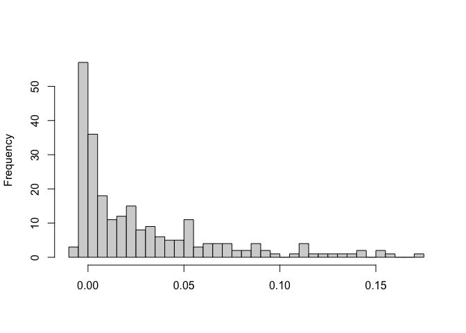<!-- -->

``` r
Fst(y21a)[, 'Fst'] |> sort() |> tail(1)
```

    ## ots_crrad66330_60 
    ##         0.1708509

``` r
Fst(y22a)[, 'Fst'] |> hist(breaks=30, main=NULL, xlab=NULL)
```

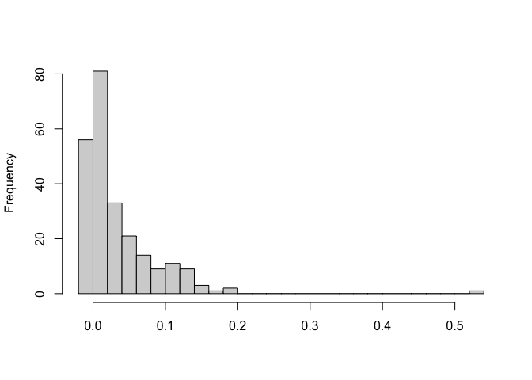<!-- -->

``` r
Fst(y22a)[, 'Fst'] |> sort() |> tail(1)
```

    ## ots_u07_07_161 
    ##      0.5345239

``` r
table(y22a$population, y22a$ots_u07_07_161, useNA="ifany")
```

    ##       
    ##        C/C C/T T/T <NA>
    ##   FALL   0   0  47   75
    ##   NOR   66  79  19    0

``` r
Fst(y23a)[, 'Fst'] |> hist(breaks=30, main=NULL, xlab=NULL)
```

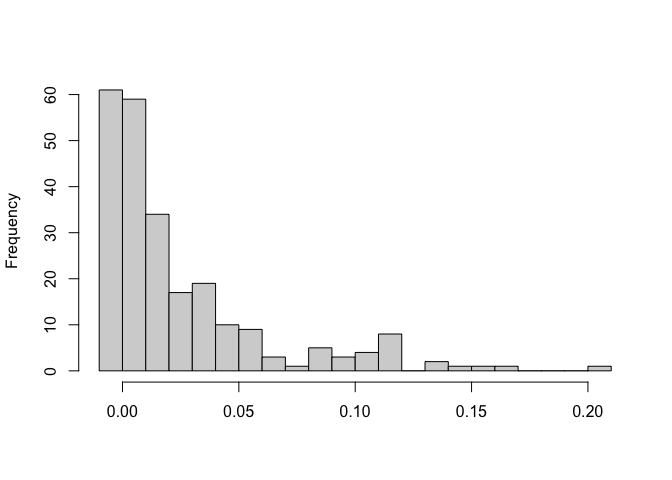<!-- -->

``` r
Fst(y23a)[, 'Fst'] |> sort() |> tail(1)
```

    ## ots_crrad66330_60 
    ##         0.2050146

``` r
Fst(y24a)[, 'Fst'] |> hist(breaks=30, main=NULL, xlab=NULL)
```

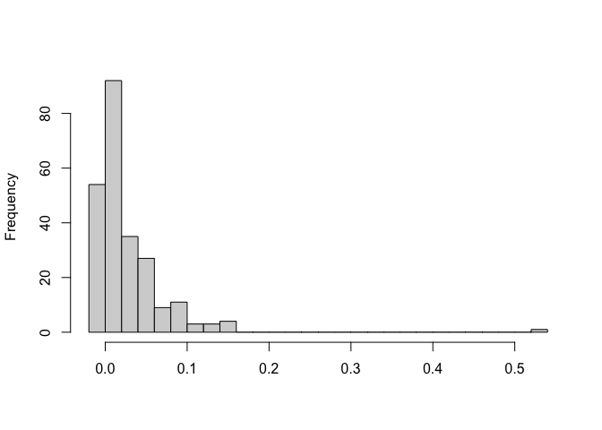<!-- -->

``` r
Fst(y24a)[, 'Fst'] |> sort() |> tail(1)
```

    ## ots_u07_07_161 
    ##      0.5242859

``` r
table(y24a$population, y24a$ots_u07_07_161, useNA="ifany")
```

    ##       
    ##        C/C C/T T/T <NA>
    ##   FALL   0   0  47   75
    ##   NOR   76  82  25    1

``` r
Fst(y25a)[, 'Fst'] |> hist(breaks=30, main=NULL, xlab=NULL)
```

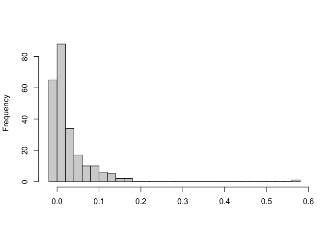<!-- -->

``` r
Fst(y25a)[, 'Fst'] |> sort() |> tail(1)
```

    ## ots_u07_07_161 
    ##        0.56539

``` r
table(y25a$population, y25a$ots_u07_07_161, useNA="ifany")
```

    ##       
    ##        C/C C/T T/T <NA>
    ##   FALL   0   0  47   75
    ##   NOR   39  56   9    2

``` r
Fst(y26a)[, 'Fst'] |> hist(breaks=30, main=NULL, xlab=NULL)
```

<!-- -->

``` r
Fst(y26a)[, 'Fst'] |> sort() |> tail(1)
```

    ## ots_u07_07_161 
    ##      0.5130525

``` r
table(y26a$population, y26a$ots_u07_07_161, useNA="ifany")
```

    ##       
    ##        C/C C/T T/T <NA>
    ##   FALL   0   0  47   75
    ##   NOR   59  61  25    1

``` r
table(y21a$population, y21a$ots_u07_07_161, useNA="ifany")
```

    ##       
    ##        T/T <NA>
    ##   FALL  47   75
    ##   NOR   71   57

``` r
table(y22a$population, y22a$ots_u07_07_161, useNA="ifany")
```

    ##       
    ##        C/C C/T T/T <NA>
    ##   FALL   0   0  47   75
    ##   NOR   66  79  19    0

``` r
table(y23a$population, y23a$ots_u07_07_161, useNA="ifany")
```

    ##       
    ##        T/T <NA>
    ##   FALL  47   75
    ##   NOR   62   45

``` r
table(y24a$population, y24a$ots_u07_07_161, useNA="ifany")
```

    ##       
    ##        C/C C/T T/T <NA>
    ##   FALL   0   0  47   75
    ##   NOR   76  82  25    1

``` r
table(y25a$population, y25a$ots_u07_07_161, useNA="ifany")
```

    ##       
    ##        C/C C/T T/T <NA>
    ##   FALL   0   0  47   75
    ##   NOR   39  56   9    2

``` r
table(y26a$population, y26a$ots_u07_07_161, useNA="ifany")
```

    ##       
    ##        C/C C/T T/T <NA>
    ##   FALL   0   0  47   75
    ##   NOR   59  61  25    1

``` r
table(y21b$population, y21b$ots_u07_07_161, useNA="ifany")
```

    ##       
    ##        C/C C/T T/T <NA>
    ##   FALL  53  37   5    0
    ##   NOR    0   0  71   57

``` r
table(y22b$population, y22b$ots_u07_07_161, useNA="ifany")
```

    ##       
    ##        C/C C/T T/T
    ##   FALL  53  37   5
    ##   NOR   66  79  19

``` r
table(y23b$population, y23b$ots_u07_07_161, useNA="ifany")
```

    ##       
    ##        C/C C/T T/T <NA>
    ##   FALL  53  37   5    0
    ##   NOR    0   0  62   45

``` r
table(y24b$population, y24b$ots_u07_07_161, useNA="ifany")
```

    ##       
    ##        C/C C/T T/T <NA>
    ##   FALL  53  37   5    0
    ##   NOR   76  82  25    1

``` r
table(y25b$population, y25b$ots_u07_07_161, useNA="ifany")
```

    ##       
    ##        C/C C/T T/T <NA>
    ##   FALL  53  37   5    0
    ##   NOR   39  56   9    2

``` r
table(y26b$population, y26b$ots_u07_07_161, useNA="ifany")
```

    ##       
    ##        C/C C/T T/T <NA>
    ##   FALL  53  37   5    0
    ##   NOR   59  61  25    1

# The End

#### Green River origin (GRO) fall-run Chinook salmon in DFW genetic baseline.

``` r
kable(
  tab1,
  col.names=c("Collection Name", "N"),
  align="l")
```

The 1998 baseline samples were excluded because there was high missing
data.

#### White River NORs (2021-2026) with genetic stock assignments.

``` r
kable(
  tab2,
  col.names=c("DFW Code", "Genetic Stock Assignment", "N"),
  align="l")
```

#### FST

FST was estimated each year by taking a random sample of n=100 White
River NORs (without regards to DFW genetic stock assignments) and a
random sample of n=100 GRO fall baseline fish (from the N=122 fish
available in the pooled 2008, 2010, and 2012 baseline collections).
EDIT: the same sample of n=100 GRO fall baseline fish was used for all 6
estimates. I reasoned that this was better than the ‘moving target’
situation I had originally used. There were a total of 6 FST estimates
that were made over 2021 to 2026 between White River NORs and GRO fall
run.

The 95% CIs for FSTs were constructed by bootstrapping. The
distributions of FST estimates with 95% CIs are plotted below. FST
estimates vary among years but 95% CIs overlap. Overlapping 95% CIs are
a heuristic for “not significantly different”.

#### ∆FST

Non-parametric statistical hypothesis tests of ∆FST were all
non-significant, indicating that allele frequency differences between
White River NORs and GRO fall run Chinook salmon are maintained. In
other words, there is no evidence for hybridization w/ introgression
during the study period.

More work is needed to establish standards for comparison. Furthermore,
additional baseline data from recently-collected NOR fall run fish from
the Puyallup River and White River would improve the quality of this
analysis.
