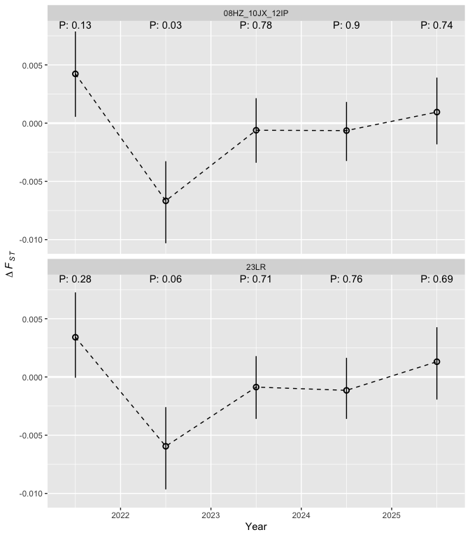

Statistical Hypothesis Test for Hybridization w/ Introgression
================
Tyler McCraney, Northwest Indian Fisheries Commission

This is a revised version of a statistical hypothesis test for
hybridization w/ introgression of White River Spring (WRS) and
Puyallup/Green River Fall (GRF) populations of Chinook salmon.

The WRS and GRF populations exhibit a moderate degree of genetic
structure (e.g., $F_{ST}=0.03$) and individual fish can be assigned with
a high degree of certainty in GSI applications. The WRS population is
supplemented by conservation hatcheries while the GRF population is
supplemented by production hatcheries.

Concerns have been raised about the potential risk of hybridization w/
introgression of the smaller WRS and the larger GRF populations. A
genetics-based test is desired to determine if hybridization w/
introgression is happening because of GRF hatchery production.

When hybridization w/ introgression happens, differences in allele
frequencies between populations are lost. So after this happens there
are no differences in allele frequencies between ‘population’ samples
that are greater than would be expected to happen by chance alone.

$F_{ST}$ measures allele frequency differences between samples. It
ranges from $F_{ST}=0$, indicating no genetic difference between two
samples, to $F_{ST}=1$, indicating complete genetic difference between
the two samples (i.e., when $F_{ST}=1$, sample 1 is completely
homozygous for allele 1 and sample 2 is completely homozygous for allele
2).

If hybridization w/ introgression is happening, then one would expect
$F_{ST}$ estimates for WRS and GRF to decrease, eventually becoming 0.
Therefore, the test statistic is the difference in $F_{ST}$
($\Delta F_{ST}$) estimated at time 1 (t1) and t2. For instance, if
$F_{ST}=0.025$ at t1 and $F_{ST}=0.005$ at t2, then our test statistic
is $\Delta F_{ST}=0.005-0.025=-0.02$. Alternatively, $\Delta F_{ST}$
could be positive, which would indicate an increase in $F_{ST}$
estimated at t1 and t2.

We need a robust statistical hypothesis test to determine if our test
statistic is significantly greater than would be expected to occur by
chance alone. Permutation can be used to determine if $\Delta F_{ST}$ is
greater than would be expected by chance alone. This is similar to a
non-parameteric version of the classic two-way t test: a statistical
hypothesis test that checks whether a difference between means is
statistically significant or likely due to chance. This framework is
appropriate because $F_{ST}$ is actually the mean of many independent
$F_{ST}$ estimated from multiple loci, so we want to determine if the
mean $F_{ST}$ is significantly different at 2 sampling points.

To demonstrate the test, I analyze WRS NOR genetic data sampled
2021–2026 with two GRF baseline populations: (1) *n*=122 GRF fish from
Soos (Voights) Creek 2008–2012, and (2) *n*=95 GRF fish from Minter
Creek 2023.

I wrote 2 functions for this analysis.

1.  `nor_fall` is a helper function to prepare the genotype matrices for
    input to `perm_boot_fst`.

2.  `perm_boot_fst` is the main function that estimates the population
    genetic parameters, and generates bootstrap CIs and
    permutation-based P-values *in parallel* with functions from
    `pegas`, `hierfstat`, and `parallel` packages.

`perm_boot_fst` performs both stratified permutation and paired-locus
bootstrapping to generate P-value and 95% confidence intervals for
$\Delta F_{ST}$. The permutation algorithm is different than the
previous version shared Nov 20, 2026 for technical reasons I won’t go
into here.

``` r
nor_fall <- function(nor.code, fall){
  require(pegas)
  bind_rows(
    NOR=filter(White_R_NOR, code %in% nor.code), 
    FALL=fall, 
    .id="group") |>
    select(-population, -code) |>
    rename(population=group) |>
    mutate(population=factor(population)) |>
    as.loci()}

perm_boot_fst <- function(loci_yr1, loci_yr2, nperm=1000, nboot=1000, cores=max(1, detectCores()/2)){
  require(pegas)
  require(hierfstat)
  require(parallel)
  hf1 <- genind2hierfstat(loci2genind(loci_yr1))
  hf2 <- genind2hierfstat(loci2genind(loci_yr2))
  hf1[, 1] <- as.character(hf1[, 1])
  hf2[, 1] <- as.character(hf2[, 1])
  pops <- sort(unique(hf1[, 1]))
  if (!identical(pops, sort(unique(hf2[, 1])))){
    stop("Population labels must match between Year 1 and Year 2.")}
  if (!identical(names(hf1)[-1], names(hf2)[-1])){
    stop("Both years must contain the exact same SNPs in the same order.")}
  # Observed Fsts and test statistic
  fst1 <- wc(hf1)$FST
  fst2 <- wc(hf2)$FST
  obs_diff <- fst2-fst1
  # Stratified permutation (shuffle individuals between years within pops)
  hf_combined <- rbind(hf1, hf2)
  yr_vec <- c(rep(1, nrow(hf1)), rep(2, nrow(hf2)))
  pop_vec <- hf_combined[, 1]
  snp_mat <- hf_combined[, -1, drop=FALSE]
  null_diffs <- unlist(mclapply(seq_len(nperm), function(i){
    perm_yr <- yr_vec
    for (p in pops){
      idx <- which(pop_vec==p)
      perm_yr[idx] <- sample(yr_vec[idx], replace=FALSE)}
    p_fst1 <- wc(cbind(pop_vec[perm_yr==1], snp_mat[perm_yr==1, , drop=FALSE]))$FST
    p_fst2 <- wc(cbind(pop_vec[perm_yr==2], snp_mat[perm_yr==2, , drop=FALSE]))$FST
    p_fst2 - p_fst1}, 
    mc.cores=cores))
  # Paired locus bootstrap to generate 95% CI for the test statistic
  nloci <- ncol(hf1)-1
  pop1 <- hf1[, 1]; snps1 <- hf1[, -1, drop=FALSE]
  pop2 <- hf2[, 1]; snps2 <- hf2[, -1, drop=FALSE]
  boot_diffs <- unlist(
    mclapply(
      seq_len(nboot), 
      function(i){
        idx <- sample.int(nloci, nloci, replace=TRUE)
        b_fst1 <- wc(cbind(pop1, snps1[, idx, drop=FALSE]))$FST
        b_fst2 <- wc(cbind(pop2, snps2[, idx, drop=FALSE]))$FST
        b_fst2 - b_fst1}, 
      mc.cores=cores))
  # Two-way P-value & 95% CI
  null_clean <- null_diffs[!is.na(null_diffs)]
  null_mean <- mean(null_clean)
  p_val_two_sided <- (sum(abs(null_clean-null_mean)>=abs(obs_diff-null_mean))+1)/(length(null_clean)+1)
  ci <- quantile(boot_diffs, probs=c(0.025, 0.975), na.rm=TRUE)
  list(
    summary=c(
      Fst_Year1=round(fst1, 5),
      Fst_Year2=round(fst2, 5),
      Delta_Fst=round(obs_diff, 5),
      CI_Lower=round(as.numeric(ci[1]), 5),
      CI_Upper=round((as.numeric(ci[2])), 5),
      P_value=round(p_val_two_sided, 4)),
    null_differences=null_diffs,
    boot_differences=boot_diffs)}
```

### How much variability in allele frequencies can we expect between years just by chance alone?

Let’s use permutation to answer that. We use a 4 step permutation
algorithm: (1) shuffle individuals between years within their
populations, (2) compute the mean $F_{ST}$ from shuffled samples, (3)
compute the difference of the mean $F_{ST}$ (i.e., the permuted
$\Delta F_{ST}$), and (4) repeat steps 1-3 999 times. The non-parametric
“P-value” is simply the proportion of the permuted test statistics that
are more extreme than our observed test statistic. We use the absolute
values of $\Delta F_{ST}$ to make it 2-way, since we expect $F_{ST}$ to
increase and decrease just by chance alone in nature.

### “How much does the variation in the particular SNPs that we genotyped influence the uncertainty we observe in $F_{ST}$ and $\Delta F_{ST}$?”

Let’s use bootstrapping to answer that. For bootstrapping, we use a 4
step algoirthm: (1) random sample *n*=251 loci with replacement, (2)
compute the mean $F_{ST}$ from bootstrapped loci, (3) compute the
difference of the mean $F_{ST}$ (i.e., the bootstrap $\Delta F_{ST}$),
and (4) repeat steps 1-3 999 times. The non-parametric 95% CIs are
simply 2.5% and 97.5% quantiles of the distribution of bootstrap
$\Delta F_{ST}$.

<!-- -->

In the figure above, $\Delta F_{ST}$ is plotted with bootstrap 95% CIs
and permutation P-values for two GRF baseline populations. In other
words, there are the same NORs in top and bottom panes, but the GRFs are
different.

We see overall congruence of results among the two different GRF
baseline populations. Furthermore, the swings we observe 2021–2022 and
2022–2023 appear to have stabilized.

I completed an ancestry analysis that estimate ancestry of all samples
and compares the GSI assignments with ancestry classifications,
available
[here](https://github.com/tylermccraney/Puyallup-White/blob/main/ancestry-models3.md).
