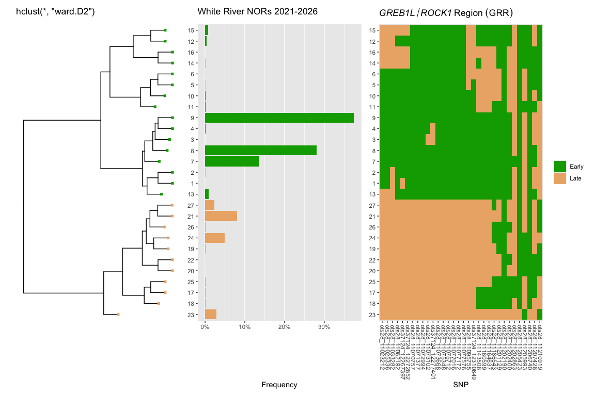
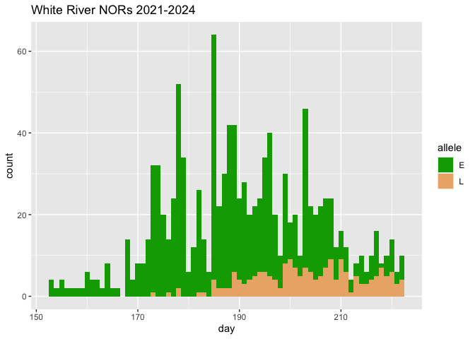
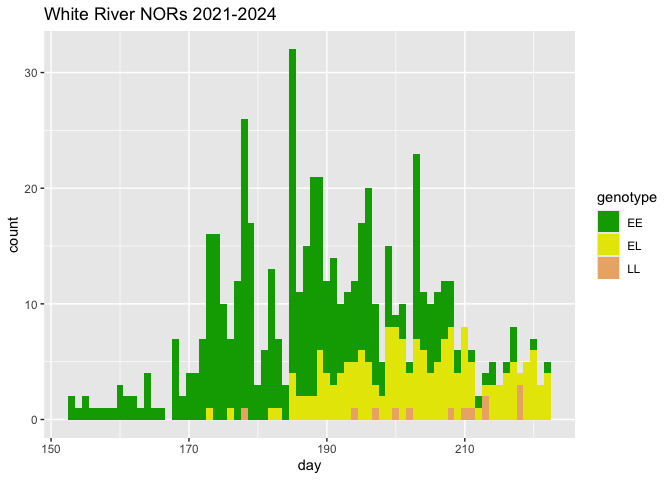
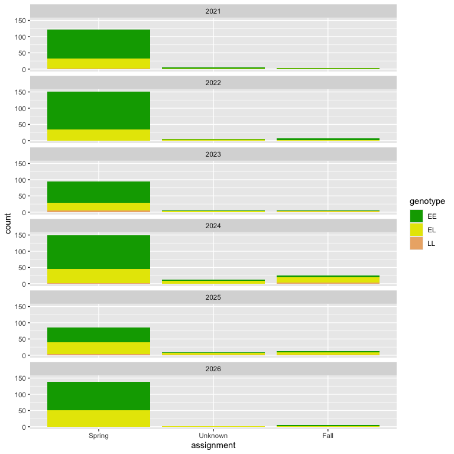

Exploratory Analysis of Run Timing Genetics
================
Tyler McCraney

``` r
library(tidyverse)
library(ggtree)
library(patchwork)

rdat <- 
  readRDS("../data/rdat.RDS")

dat <- 
  readRDS("../data/dat.RDS")

select(dat, 299:331) |> 
  as.matrix.data.frame() |> 
  is.na() |> 
  colSums() |> 
  sort()
```

    ##    ots28_11023212    ots28_11075348    ots28_11070757    ots28_11071377 
    ##               497               497               498               498 
    ##    ots28_11073668    ots28_11077016    ots28_11201129    ots28_11205423 
    ##               498               498               498               498 
    ##    ots28_11206740    ots28_11210919    ots28_11072994    ots28_11075712 
    ##               498               498               499               499 
    ##    ots28_11062192    ots28_11205993    ots28_11164637    ots28_11160599 
    ##               500               500               501               502 
    ##    ots28_11207428    ots28_11202400    ots28_11077576 ots37124_12272852 
    ##               503               504               506               508 
    ##    ots28_11095755    ots28_11025336    ots28_11077172    ots28_11186543 
    ##               509               511               512               517 
    ##    ots28_11202863    ots28_11073102    ots28_11033282 ots37124_12277401 
    ##               518               528               534               535 
    ##    ots28_11143508 ots37124_12310649    ots28_11202190 ots37124_12267397 
    ##               537               547               564               596 
    ## ots37124_12281207 
    ##               778

``` r
# ots37124_12281207 removed for 33% missing data
rtd <-
  select(dat, 3, 335, 299:329, 331) |> 
  rowwise() |> 
  mutate(prop=sum(across(2:34, ~!is.na(.)))/32) |> 
  ungroup() |> 
  relocate(prop, .after=id) |> 
  filter(prop>=0.75)

tdat <- 
  left_join(x=rtd, y=rename(rdat, id=wdfw_id)) |> 
  relocate(36:50, .after=id) |>
  relocate(ots37124_12267397, ots37124_12272852, .after=ots28_11062192) |> 
  relocate(ots37124_12277401, .after=ots28_11073102) |> 
  relocate(ots37124_12310649, .after=ots28_11095755) |> 
  filter(is.na(comment)) |>
  select(-genotypingsuccess, -comment) |> 
  mutate(year=ifelse(is.na(year), yes=(str_extract(string=id, pattern="^\\d{2}") |> as.numeric())+2000, no=year))

tdat <- 
  arrange(tdat, id) |>
  mutate(length=if_else(condition=length>100, true=length/10, false=length), psex=sex, gsex=ots_sexy3_1) |> 
  relocate(49:50, .before=sex)

tdat$gsex <- 
  replace_values(
    tdat$gsex,
    "XX" ~ "F", 
    "XY" ~ "M")

tdat <- 
  mutate(
    tdat, 
    sex=if_else(gsex==psex, true=gsex, false=NA, missing=gsex), 
    sex=if_else(is.na(gsex), true=psex, false=sex))

tdat <- 
  slice(tdat, -535)

tdat32 <- 
  select(tdat, 1, 19:50)

gt32 <- 
  separate_wider_position(tdat32, cols=2:33, widths=c(a1=1, a2=1), names_sep="_") |>
  column_to_rownames(var="id") |>
  as.matrix()

ht32 <- 
  haplo.stats::haplo.em(geno=gt32, locus.label=names(select(tdat, 19:50)))

ht32haps <- 
  ht32$haplotype

E0L1 <- 
  mutate(
    ht32haps, 
    ots28_11023212=recode_values(ots28_11023212, "A" ~ 0, "G" ~ 1),
    ots28_11025336=recode_values(ots28_11025336, "A" ~ 0, "C" ~ 1),
    ots28_11033282=recode_values(ots28_11033282, "G" ~ 0, "A" ~ 1),
    ots28_11062192=recode_values(ots28_11062192, "C" ~ 0, "G" ~ 1),
    ots37124_12267397=recode_values(ots37124_12267397, "T" ~ 0, "C" ~ 1),
    ots37124_12272852=recode_values(ots37124_12272852, "T" ~ 0, "C" ~ 1),
    ots28_11070757=recode_values(ots28_11070757, "A" ~ 0, "G" ~ 1),
    ots28_11071377=recode_values(ots28_11071377, "T" ~ 0, "C" ~ 1),
    ots28_11072994=recode_values(ots28_11072994, "C" ~ 0, "T" ~ 1),
    ots28_11073102=recode_values(ots28_11073102, "T" ~ 0, "A" ~ 1),
    ots37124_12277401=recode_values(ots37124_12277401, "T" ~ 0, "A" ~ 1),
    ots28_11073668=recode_values(ots28_11073668, "T" ~ 0, "A" ~ 1),
    ots28_11075348=recode_values(ots28_11075348, "G" ~ 0, "A" ~ 1),
    ots28_11075712=recode_values(ots28_11075712, "C" ~ 0, "T" ~ 1),
    ots28_11077016=recode_values(ots28_11077016, "C" ~ 0, "T" ~ 1),
    ots28_11077172=recode_values(ots28_11077172, "G" ~ 0, "A" ~ 1),
    # ots37124_12281207=recode_values(ots37124_12281207, "T" ~ 0, "A" ~ 1), # low quality SNP
    ots28_11077576=recode_values(ots28_11077576, "A" ~ 0, "G" ~ 1),
    ots28_11095755=recode_values(ots28_11095755, "T" ~ 0, "A" ~ 1),
    ots37124_12310649=recode_values(ots37124_12310649, "A" ~ 0, "T" ~ 1),
    ots28_11143508=recode_values(ots28_11143508, "A" ~ 0, "G" ~ 1),
    ots28_11160599=recode_values(ots28_11160599, "T" ~ 0, "G" ~ 1),
    ots28_11164637=recode_values(ots28_11164637, "A" ~ 0, "C" ~ 1),
    ots28_11186543=recode_values(ots28_11186543, "T" ~ 0, "A" ~ 1),
    ots28_11201129=recode_values(ots28_11201129, "G" ~ 0, "T" ~ 1),
    ots28_11202190=recode_values(ots28_11202190, "C" ~ 0, "T" ~ 1),
    ots28_11202400=recode_values(ots28_11202400, "T" ~ 0, "C" ~ 1),
    ots28_11202863=recode_values(ots28_11202863, "A" ~ 0, "C" ~ 1),
    ots28_11205423=recode_values(ots28_11205423, "G" ~ 0, "A" ~ 1),
    ots28_11205993=recode_values(ots28_11205993, "C" ~ 0, "T" ~ 1), 
    ots28_11206740=recode_values(ots28_11206740, "C" ~ 0, "T" ~ 1),
    ots28_11207428=recode_values(ots28_11207428, "G" ~ 0, "T" ~ 1),
    ots28_11210919=recode_values(ots28_11210919, "C" ~ 0, "T" ~ 1))


E0L1 <- 
  as.matrix(E0L1)

E0L1s <- 
  scale(E0L1)

E0L1sd <- 
  dist(E0L1s)

E0L1sdh <- 
  hclust(E0L1sd, method="ward.D2")

plot(E0L1sdh)
```

<!-- -->

``` r
cd <- 
  ggtree(as.dendrogram(E0L1sdh)) %<+%
  tibble(label=as.character(1:27), allele=cutree(E0L1sdh, k=2) |> factor(levels=1:2, labels=c("E", "L"))) +
  geom_tippoint(aes(label=label, color=allele), shape=15, show.legend=FALSE) +
  scale_color_manual(values=terrain.colors(4)[c(1, 3)]) +
  labs(title='hclust(*, "ward.D2")') + 
  theme_dendrogram()


gg0 <- 
  tibble(Var1=factor(1:27, levels=E0L1sdh$order, ordered=TRUE), hap.prob=ht32$hap.prob, allele=cutree(E0L1sdh, k=2) |> factor(levels=1:2, labels=c("E", "L"))) |>
  ggplot(aes(x=hap.prob, y=Var1, fill=allele)) + 
  geom_col(show.legend=FALSE) +
  scale_fill_manual(name=NULL, values=terrain.colors(4)[c(1, 3)]) +
  scale_x_continuous(labels=scales::label_percent()) +
  labs(x="Frequency", title="White River NORs 2021-2026", y=NULL) +
  theme(panel.grid.minor.y=element_blank(), panel.grid.major.y=element_blank())


rownames(E0L1) <- 
  1:27

df <- 
  as.data.frame(as.table(E0L1)) |> 
  left_join(y=tibble(Var1=factor(1:27), hap.prob=ht32$hap.prob)) |>
  mutate(Freq=factor(Freq, levels=c(0, 1), labels=c("Early", "Late")))

df$Var1 <- 
  factor(df$Var1, levels=E0L1sdh$order, ordered=TRUE)


gg1 <- 
  ggplot(df, aes(x=Var2, y=Var1, fill=Freq)) + 
  geom_tile() +
  scale_fill_manual(name=NULL, values=terrain.colors(4)[c(1, 3)]) +
  labs(x="SNP", y=NULL, title=expression(italic('GREB1L')/italic('ROCK1')~Region~(GRR))) +
  theme(axis.text.x=element_text(angle=270, hjust=0, vjust=0.4), panel.grid=element_blank())
```

``` r
cd + gg0 + gg1
```

<!-- -->

``` r
ht32tab <- 
  tibble(
    indx.subj=ht32$indx.subj, 
    subj.id=ht32$subj.id, 
    hap1=ht32$hap1code, 
    hap2=ht32$hap2code, 
    post=ht32$post)

tail(ht32tab)
```

    ## # A tibble: 6 × 5
    ##   indx.subj subj.id  hap1  hap2    post
    ##       <dbl>   <int> <dbl> <dbl>   <dbl>
    ## 1       835     835     4    23 0.00166
    ## 2       835     835     9    23 0.998  
    ## 3       836     836     9    24 1      
    ## 4       837     837     9    23 1      
    ## 5       838     838    21     8 1      
    ## 6       839     839     9    12 1

``` r
ht32tab1 <- 
  group_by(ht32tab, indx.subj, subj.id) |> 
  slice_max(post) |> 
  ungroup() |> 
  arrange(indx.subj) |>
  mutate(ID=rownames(gt32))

haplogroups <-
  list(
    L=E0L1sdh$order[1:11],
    E=E0L1sdh$order[12:27])

df1 <- 
  tibble(hap=1:27, hap.prob=ht32$hap.prob)

df1 <- 
  mutate(
    df1, 
    hap.group=factor(
      hap, 
      levels=c(haplogroups$E, haplogroups$L), 
      labels=c(rep("E", length(haplogroups$E)), rep("L", length(haplogroups$L)))))

ht32tab1 <- 
  left_join(x=ht32tab1, y=df1, by=join_by(hap1==hap)) |> 
  rename(hap1.prob=hap.prob, hap1.group=hap.group) |> 
  left_join(y=df1, by=join_by(hap2==hap)) |> 
  rename(hap2.prob=hap.prob, hap2.group=hap.group)

ht32tab1 <- 
  left_join(x=ht32tab1, y=select(tdat, 1:17), by=join_by(ID==id))


ht32tab2 <- 
  pivot_longer(ht32tab1, cols=c(hap1, hap2), names_to="allele", names_prefix="hap", names_transform=list(allele=as.integer), values_to="hap") |>
  group_by(hap) |> 
  count(sort=TRUE) |> 
  ungroup() |>
  left_join(y=df1[-2]) |> 
  group_by(hap.group) %>%
  mutate(hap.rank=ntile(hap.group, n=nrow(.)), haplotype=paste0(hap.group, hap.rank))

ht32tab3 <- 
  pivot_longer(ht32tab1, cols=c(hap1, hap2), names_to="allele", names_prefix="hap", names_transform=list(allele=as.integer), values_to="hap") |>
  left_join(y=df1[-2]) |> 
  left_join(y=ht32tab2) |>
  mutate(day=yday(date), year=year(date)) |> 
  mutate(year=ifelse(is.na(year), yes=(str_extract(string=ID, pattern="^\\d{2}") |> as.numeric())+2000, no=year))


ht32tab2$haplotype <- 
  factor(ht32tab2$haplotype, levels=c("E1", "E10", "E11", "E12", "E2", "E3", "E4", "E5", "E6", "E7", "E8", "E9", "L1", "L10", "L2", "L3", "L4", "L5", "L6", "L7", "L8", "L9"), labels=c("E01", "E10", "E11", "E12", "E02", "E03", "E04", "E05", "E06", "E07", "E08", "E09", "L01", "L10", "L02", "L03", "L04", "L05", "L06", "L07", "L08", "L09")) |> 
  as.character()

ht32tab3$haplotype <- 
  factor(ht32tab3$haplotype, levels=c("E1", "E10", "E11", "E12", "E2", "E3", "E4", "E5", "E6", "E7", "E8", "E9", "L1", "L10", "L2", "L3", "L4", "L5", "L6", "L7", "L8", "L9"), labels=c("E01", "E10", "E11", "E12", "E02", "E03", "E04", "E05", "E06", "E07", "E08", "E09", "L01", "L10", "L02", "L03", "L04", "L05", "L06", "L07", "L08", "L09")) |> 
  as.character()

ht32tab4 <- 
  left_join(x=ht32tab1, y=ht32tab2[-2:-4], by=join_by(hap1==hap)) |> 
  rename(haplotype1=haplotype) |> 
  left_join(y=ht32tab2[-2:-4], by=join_by(hap2==hap)) |> 
  rename(haplotype2=haplotype) |>
  mutate(runtime_genotype1=paste(haplotype1, haplotype2, sep="/"), runtime_genotype2=paste0(hap1.group, hap2.group), day=yday(date)) |> 
  mutate(year=ifelse(is.na(year), yes=(str_extract(string=ID, pattern="^\\d{2}") |> as.numeric())+2000, no=year))


ht32tab4$runtime_genotype2 <- 
  factor(ht32tab4$runtime_genotype2, levels=c("EE", "EL", "LE", "LL"), labels=c("EE", "EL", "EL", "LL"))

ht32tab3$assignment <- 
  replace_values(ht32tab3$assignment, NA ~ "Unknown")

ht32tab3$assignment <-
  factor(ht32tab3$assignment, levels=c("Spring", "Unknown", "Fall"))

ht32tab4$assignment <- 
  replace_values(ht32tab4$assignment, NA ~ "Unknown")

ht32tab4$assignment <-
  factor(ht32tab4$assignment, levels=c("Spring", "Unknown", "Fall"))


gg2 <- 
  ggplot(ht32tab3 |> filter(!is.na(day)), aes(x=day, fill=haplotype)) + 
  geom_bar(width=1) + 
  labs(title="White River NORs 2021-2024") +
  scale_fill_discrete(palette=terrain.colors)

gg3 <- 
  ggplot(ht32tab3 |> filter(!is.na(day)), aes(x=day, fill=hap.group)) + 
  geom_bar(width=1) + 
  labs(title="White River NORs 2021-2024") +
  scale_fill_manual(name="allele", values=terrain.colors(4)[c(1, 3)])

gg4 <- 
  ggplot(ht32tab4 |> filter(!is.na(day)), aes(x=day, fill=runtime_genotype2)) + 
  geom_bar(width=1) + 
  labs(title="White River NORs 2021-2024") +
  scale_fill_manual(name="genotype", values=terrain.colors(4)[c(1:3)])

gg5 <- 
  ggplot(ht32tab4 |> filter(!is.na(day)), aes(x=day, fill=assignment)) + 
  geom_bar(width=1) + 
  labs(title="White River NORs 2021-2024") +
  scale_fill_manual(values=terrain.colors(4)[c(1:3)])

gg2
```

<!-- -->

``` r
gg3
```

<!-- -->

``` r
gg4
```

<!-- -->

``` r
gg5
```

<!-- -->

``` r
gg6 <- 
  ggplot(ht32tab3, aes(fill=hap.group, x=assignment)) + 
  geom_bar() + 
  facet_wrap(facet=vars(year), ncol=1) + 
  scale_fill_manual(name="allele", values=terrain.colors(4)[c(1, 3)])

gg7 <- 
  ggplot(ht32tab3, aes(fill=hap.group, x=assignment)) + 
  geom_bar(position="fill") + 
  facet_wrap(facet=vars(year), ncol=1) + 
  labs(y="proportion") +
  scale_fill_manual(name="allele", values=terrain.colors(4)[c(1, 3)])

gg8 <- 
  ggplot(ht32tab4, aes(fill=runtime_genotype2, x=assignment)) + 
  geom_bar() + 
  facet_wrap(facet=vars(year), ncol=1) +
  scale_fill_manual(name="genotype", values=terrain.colors(4)[c(1:3)])

gg9 <- 
  ggplot(ht32tab4, aes(fill=runtime_genotype2, x=assignment)) + 
  geom_bar(position="fill") + 
  facet_wrap(facet=vars(year), ncol=1) +
  labs(y="proportion") +
  scale_fill_manual(name="genotype", values=terrain.colors(4)[c(1:3)])

gg6
```

<!-- -->

``` r
gg7
```

<!-- -->

``` r
gg8
```

<!-- -->

``` r
gg9
```

<!-- -->

``` r
#
(gf0 <- pull(ht32tab4, runtime_genotype2) |> table(useNA="ifany") |> c())
```

    ##  EE  EL  LL 
    ## 547 273  19

``` r
HardyWeinberg::HWChisq(gf0)
```

    ## Chi-square test with continuity correction for Hardy-Weinberg equilibrium (autosomal)
    ## Chi2 =    4.6162 DF =    1 p-value =  0.0317 
    ##  f =  -0.0775 Ho =  0.3254 He =  0.3020

``` r
#
(gf1 <- filter(ht32tab4, year==2021) |> pull(runtime_genotype2) |> table(useNA="ifany") |> c())
```

    ## EE EL LL 
    ## 95 33  2

``` r
HardyWeinberg::HWChisq(gf1)
```

    ## Chi-square test with continuity correction for Hardy-Weinberg equilibrium (autosomal)
    ## Chi2 =    0.0253 DF =    1 p-value =  0.8735 
    ##  f =  -0.0399 Ho =  0.2538 He =  0.2441

``` r
#
(gf2 <- filter(ht32tab4, year==2022) |> pull(runtime_genotype2) |> table(useNA="ifany") |> c())
```

    ##  EE  EL  LL 
    ## 126  38   0

``` r
HardyWeinberg::HWChisq(gf2)
```

    ## Chi-square test with continuity correction for Hardy-Weinberg equilibrium (autosomal)
    ## Chi2 =    1.7906 DF =    1 p-value =  0.1808 
    ##  f =  -0.1310 Ho =  0.2317 He =  0.2049

``` r
#
(gf3 <- filter(ht32tab4, year==2023) |> pull(runtime_genotype2) |> table(useNA="ifany") |> c())
```

    ## EE EL LL 
    ## 71 30  6

``` r
HardyWeinberg::HWChisq(gf3)
```

    ## Chi-square test with continuity correction for Hardy-Weinberg equilibrium (autosomal)
    ## Chi2 =    0.8028 DF =    1 p-value =  0.3703 
    ##  f =  0.1113 Ho =  0.2804 He =  0.3155

``` r
#
(gf4 <- filter(ht32tab4, year==2024) |> pull(runtime_genotype2) |> table(useNA="ifany") |> c())
```

    ##  EE  EL  LL 
    ## 112  69   5

``` r
HardyWeinberg::HWChisq(gf4)
```

    ## Chi-square test with continuity correction for Hardy-Weinberg equilibrium (autosomal)
    ## Chi2 =    1.7001 DF =    1 p-value =  0.1923 
    ##  f =  -0.1089 Ho =  0.3710 He =  0.3345

``` r
#
(gf5 <- filter(ht32tab4, year==2025) |> pull(runtime_genotype2) |> table(useNA="ifany") |> c())
```

    ## EE EL LL 
    ## 51 49  6

``` r
HardyWeinberg::HWChisq(gf5)
```

    ## Chi-square test with continuity correction for Hardy-Weinberg equilibrium (autosomal)
    ## Chi2 =    1.2740 DF =    1 p-value =  0.2590 
    ##  f =  -0.1278 Ho =  0.4623 He =  0.4099

``` r
#
(gf6 <- filter(ht32tab4, year==2026) |> pull(runtime_genotype2) |> table(useNA="ifany") |> c())
```

    ## EE EL LL 
    ## 92 54  0

``` r
HardyWeinberg::HWChisq(gf6)
```

    ## Chi-square test with continuity correction for Hardy-Weinberg equilibrium (autosomal)
    ## Chi2 =    6.2960 DF =    1 p-value =  0.0121 
    ##  f =  -0.2269 Ho =  0.3699 He =  0.3015

``` r
#
(gf1_5 <- filter(ht32tab4, year %in% 2021:2025) |> pull(runtime_genotype2) |> table(useNA="ifany") |> c())
```

    ##  EE  EL  LL 
    ## 455 219  19

``` r
HardyWeinberg::HWChisq(gf1_5)
```

    ## Chi-square test with continuity correction for Hardy-Weinberg equilibrium (autosomal)
    ## Chi2 =    1.2269 DF =    1 p-value =  0.2680 
    ##  f =  -0.0461 Ho =  0.3160 He =  0.3021

``` r
#
(gfS <- filter(ht32tab4, assignment=="Spring") |> pull(runtime_genotype2) |> table(useNA="ifany") |> c())
```

    ##  EE  EL  LL 
    ## 510 219  12

``` r
HardyWeinberg::HWChisq(gfS)
```

    ## Chi-square test with continuity correction for Hardy-Weinberg equilibrium (autosomal)
    ## Chi2 =    4.0304 DF =    1 p-value =  0.0447 
    ##  f =  -0.0780 Ho =  0.2955 He =  0.2742

``` r
#
(gfUF <- filter(ht32tab4, assignment!="Spring") |> pull(runtime_genotype2) |> table(useNA="ifany") |> c())
```

    ## EE EL LL 
    ## 37 54  7

``` r
HardyWeinberg::HWChisq(gfUF)
```

    ## Chi-square test with continuity correction for Hardy-Weinberg equilibrium (autosomal)
    ## Chi2 =    3.8675 DF =    1 p-value =  0.0492 
    ##  f =  -0.2160 Ho =  0.5510 He =  0.4531
