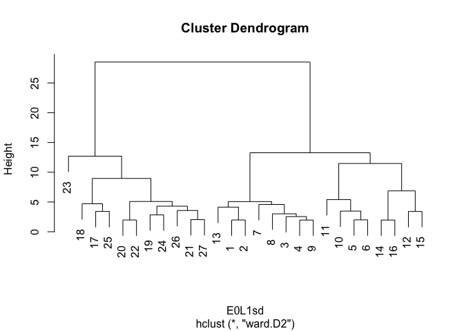
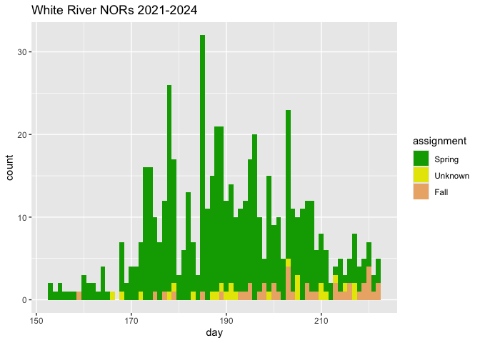
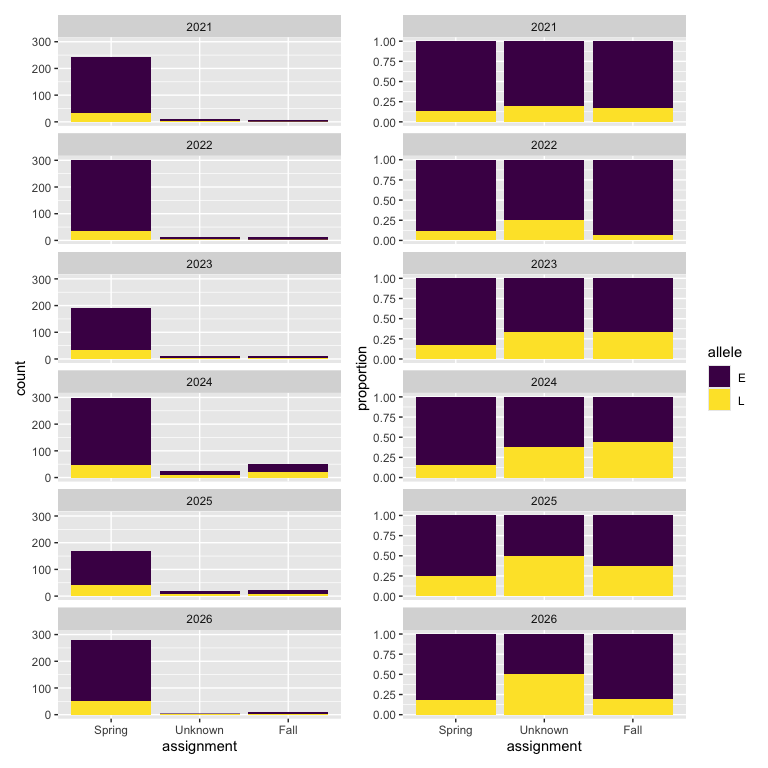
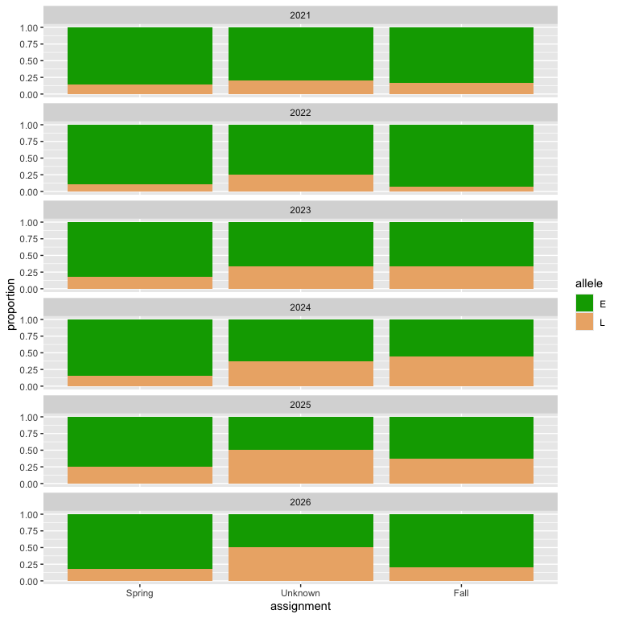
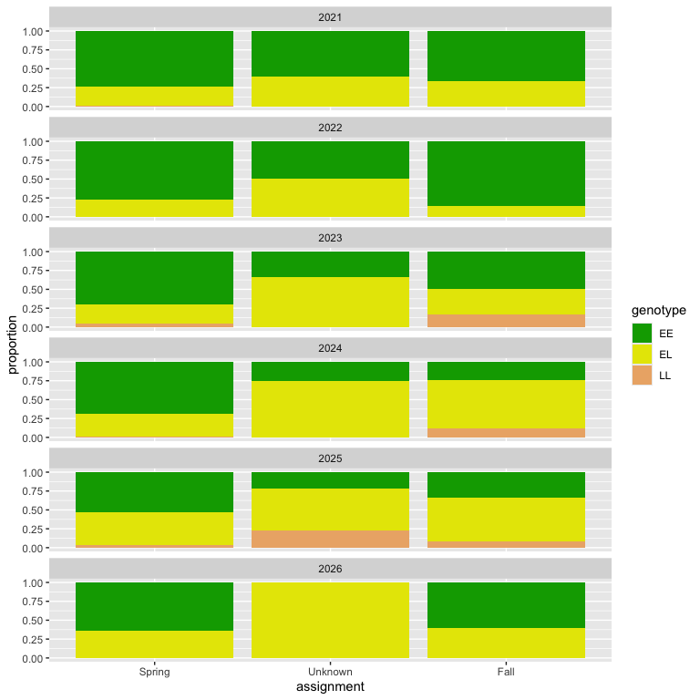

Exploratory Analysis of Run Timing Genetics
================
Tyler McCraney

    ##    ots28_11023212    ots28_11075348    ots28_11070757    ots28_11071377 
    ##               497               497               498               498 
    ##    ots28_11073668    ots28_11077016    ots28_11201129    ots28_11205423 
    ##               498               498               498               498 
    ##    ots28_11206740    ots28_11210919    ots28_11072994    ots28_11075712 
    ##               498               498               499               499 
    ##    ots28_11062192    ots28_11205993    ots28_11164637    ots28_11160599 
    ##               500               500               501               502 
    ##    ots28_11207428    ots28_11202400    ots28_11077576 ots37124_12272852 
    ##               503               504               506               508 
    ##    ots28_11095755    ots28_11025336    ots28_11077172    ots28_11186543 
    ##               509               511               512               517 
    ##    ots28_11202863    ots28_11073102    ots28_11033282 ots37124_12277401 
    ##               518               528               534               535 
    ##    ots28_11143508 ots37124_12310649    ots28_11202190 ots37124_12267397 
    ##               537               547               564               596 
    ## ots37124_12281207 
    ##               778

<!-- -->

<!-- -->

#### Distribution of haplotypes, alleles, genotypes, and genetic stock assignments

<!-- --><!-- --><!-- --><!-- -->

<!-- --><!-- --><!-- --><!-- -->

Selection against heterozygotes (underdominance)?

#### GRR genotypes in Hardy-Weinberg Equilibrium 2021-2025 (both individually and combined). Not in HWE when 2026 added, or 2026 individually, 2026 spring, and 2026 non-spring.

``` r
#
(gf0 <- pull(ht32tab4, runtime_genotype2) |> table(useNA="ifany") |> c())
```

    ##  EE  EL  LL 
    ## 547 273  19

``` r
HardyWeinberg::HWChisq(gf0)
```

    ## Chi-square test with continuity correction for Hardy-Weinberg equilibrium (autosomal)
    ## Chi2 =    4.6162 DF =    1 p-value =  0.0317 
    ##  f =  -0.0775 Ho =  0.3254 He =  0.3020

``` r
#
(gf1 <- filter(ht32tab4, year==2021) |> pull(runtime_genotype2) |> table(useNA="ifany") |> c())
```

    ## EE EL LL 
    ## 95 33  2

``` r
HardyWeinberg::HWChisq(gf1)
```

    ## Chi-square test with continuity correction for Hardy-Weinberg equilibrium (autosomal)
    ## Chi2 =    0.0253 DF =    1 p-value =  0.8735 
    ##  f =  -0.0399 Ho =  0.2538 He =  0.2441

``` r
#
(gf2 <- filter(ht32tab4, year==2022) |> pull(runtime_genotype2) |> table(useNA="ifany") |> c())
```

    ##  EE  EL  LL 
    ## 126  38   0

``` r
HardyWeinberg::HWChisq(gf2)
```

    ## Chi-square test with continuity correction for Hardy-Weinberg equilibrium (autosomal)
    ## Chi2 =    1.7906 DF =    1 p-value =  0.1808 
    ##  f =  -0.1310 Ho =  0.2317 He =  0.2049

``` r
#
(gf3 <- filter(ht32tab4, year==2023) |> pull(runtime_genotype2) |> table(useNA="ifany") |> c())
```

    ## EE EL LL 
    ## 71 30  6

``` r
HardyWeinberg::HWChisq(gf3)
```

    ## Chi-square test with continuity correction for Hardy-Weinberg equilibrium (autosomal)
    ## Chi2 =    0.8028 DF =    1 p-value =  0.3703 
    ##  f =  0.1113 Ho =  0.2804 He =  0.3155

``` r
#
(gf4 <- filter(ht32tab4, year==2024) |> pull(runtime_genotype2) |> table(useNA="ifany") |> c())
```

    ##  EE  EL  LL 
    ## 112  69   5

``` r
HardyWeinberg::HWChisq(gf4)
```

    ## Chi-square test with continuity correction for Hardy-Weinberg equilibrium (autosomal)
    ## Chi2 =    1.7001 DF =    1 p-value =  0.1923 
    ##  f =  -0.1089 Ho =  0.3710 He =  0.3345

``` r
#
(gf5 <- filter(ht32tab4, year==2025) |> pull(runtime_genotype2) |> table(useNA="ifany") |> c())
```

    ## EE EL LL 
    ## 51 49  6

``` r
HardyWeinberg::HWChisq(gf5)
```

    ## Chi-square test with continuity correction for Hardy-Weinberg equilibrium (autosomal)
    ## Chi2 =    1.2740 DF =    1 p-value =  0.2590 
    ##  f =  -0.1278 Ho =  0.4623 He =  0.4099

``` r
#
(gf6 <- filter(ht32tab4, year==2026) |> pull(runtime_genotype2) |> table(useNA="ifany") |> c())
```

    ## EE EL LL 
    ## 92 54  0

``` r
HardyWeinberg::HWChisq(gf6)
```

    ## Chi-square test with continuity correction for Hardy-Weinberg equilibrium (autosomal)
    ## Chi2 =    6.2960 DF =    1 p-value =  0.0121 
    ##  f =  -0.2269 Ho =  0.3699 He =  0.3015

``` r
#
(gf1_5 <- filter(ht32tab4, year %in% 2021:2025) |> pull(runtime_genotype2) |> table(useNA="ifany") |> c())
```

    ##  EE  EL  LL 
    ## 455 219  19

``` r
HardyWeinberg::HWChisq(gf1_5)
```

    ## Chi-square test with continuity correction for Hardy-Weinberg equilibrium (autosomal)
    ## Chi2 =    1.2269 DF =    1 p-value =  0.2680 
    ##  f =  -0.0461 Ho =  0.3160 He =  0.3021

``` r
#
(gfS <- filter(ht32tab4, assignment=="Spring") |> pull(runtime_genotype2) |> table(useNA="ifany") |> c())
```

    ##  EE  EL  LL 
    ## 510 219  12

``` r
HardyWeinberg::HWChisq(gfS)
```

    ## Chi-square test with continuity correction for Hardy-Weinberg equilibrium (autosomal)
    ## Chi2 =    4.0304 DF =    1 p-value =  0.0447 
    ##  f =  -0.0780 Ho =  0.2955 He =  0.2742

``` r
#
(gfUF <- filter(ht32tab4, assignment!="Spring") |> pull(runtime_genotype2) |> table(useNA="ifany") |> c())
```

    ## EE EL LL 
    ## 37 54  7

``` r
HardyWeinberg::HWChisq(gfUF)
```

    ## Chi-square test with continuity correction for Hardy-Weinberg equilibrium (autosomal)
    ## Chi2 =    3.8675 DF =    1 p-value =  0.0492 
    ##  f =  -0.2160 Ho =  0.5510 He =  0.4531
